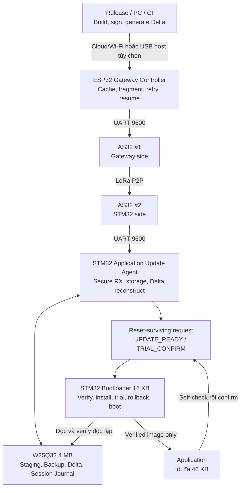
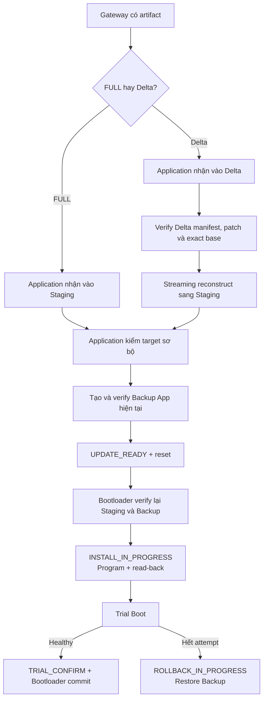

# Aegis-OTA Hybrid Secure Update Framework

> **Aegis-OTA** là framework cập nhật firmware an toàn cho
> **STM32F103C8T6** qua **LoRa P2P**. Hệ thống dùng ESP32 làm Gateway
> Controller, hai module AS32-TTL-100-C làm liên kết radio, W25Q32 4 MB làm
> workspace bền vững và Bootloader STM32 làm authority cuối cho việc xác thực,
> cài đặt, Trial Boot và rollback.

## Lưu ý về trạng thái dự án

- Đây là bản thử nghiệm và reference implementation phục vụ nghiên cứu, học tập
  và nghiệm thu kiến trúc Aegis-OTA; chưa nên dùng trực tiếp cho sản phẩm thương mại
  hoặc hệ thống an toàn quan trọng.
- Dự án cần tiếp tục chạy trên đúng phần cứng thật và thu thập số liệu về RF,
  timeout, packet loss, throughput, nguồn, fault injection và FULL/Delta OTA
  end-to-end để hoàn thành bộ bằng chứng nghiệm thu cuối cùng.

## Mục tiêu

Project giải quyết bài toán cập nhật firmware qua đường truyền LoRa P2P băng
thông thấp nhưng vẫn phải đáp ứng các bất biến sau:

- chỉ firmware được Release Authority ký mới được cài;
- packet loss, mất ACK, reset hoặc mất điện không tạo trạng thái nửa vời;
- Delta không patch trực tiếp Application đang chạy;
- firmware mới phải vượt qua Trial Boot trước khi được xác nhận;
- khi candidate lỗi, thiết bị giữ App hiện tại hoặc rollback về Backup hợp lệ;
- Recovery chỉ được dùng khi không còn đường boot/install/rollback an toàn.

## Tính năng đích

| Nhóm | Tính năng | Vai trò |
|---|---|---|
| Firmware authentication | SHA-512 + Ed25519ph | Hash 64 bytes, signature 64 bytes, public key 32 bytes |
| Secure transport | ChaCha20-Poly1305 | Key 32 bytes, nonce 12 bytes, TAG 16 bytes |
| FULL OTA | Signed FULL artifact | Baseline cập nhật và phương án fallback |
| Delta OTA | Host tạo patch, STM32 streaming apply | Giảm số byte truyền qua LoRa |
| Reliability | ACK/NACK, timeout, retry, duplicate, resume | Chịu đường truyền không ổn định |
| Storage | Staging, Backup, Delta và Session Journal trên W25Q32 | Workspace transaction-safe và chống replay qua reset |
| Boot safety | Metadata A/B, Trial Boot, IWDG | Quyết định xác định sau reset |
| Rollback | Restore Backup rồi verify | Quay về firmware cũ khi trial thất bại |
| Gateway | ESP32 Gateway Controller | Cache, chia frame, gửi và theo dõi tiến độ |
| Radio | Hai AS32-TTL-100-C | Liên kết UART ↔ LoRa P2P ↔ UART |
| Validation | Fault/security/RF tests | Chứng minh failure path và giới hạn thực tế |

## Kiến trúc

Hai AS32 dùng UART `9600 8N1` ở cả phía ESP32 và STM32. USART2 PA2/PA3 trên
STM32 chỉ dành cho debug cục bộ tùy chọn ở `115200 8N1`, mặc định không khởi tạo
và không thuộc OTA hoặc Recovery. Recovery chính thức dùng ST-Link/SWD.

AS32 chỉ vận chuyển byte ở transparent mode. Application Update Agent chuẩn bị
candidate nhưng không có quyền công nhận candidate. Trước khi erase Internal
Application, Bootloader luôn tự kiểm manifest, identity, version, SHA-512 và
Ed25519ph bằng public key được provision trong Bootloader.

## Luồng FULL và Delta

## Memory contract

| Internal Flash | Address | Size |
|---|---|---:|
| Bootloader | `0x08000000..0x08003FFF` | 16 KB |
| Application | `0x08004000..0x0800F7FF` | 46 KB |
| Metadata A | `0x0800F800..0x0800FBFF` | 1 KB |
| Metadata B | `0x0800FC00..0x0800FFFF` | 1 KB |

| W25Q32 | Address | Size |
|---|---|---:|
| Staging | `0x000000..0x03FFFF` | 256 KB |
| Backup | `0x040000..0x07FFFF` | 256 KB |
| Delta | `0x080000..0x0BFFFF` | 256 KB |
| Reserved | `0x0C0000..0x3FFFFF` | 3.25 MB |

Trong Reserved, 64 KB đầu (`0x0C0000..0x0CFFFF`) là Session Journal append-only
để chặn reuse secure-session qua reset; 3.1875 MB còn lại vẫn dành cho mở rộng.

Mỗi vùng Staging, Backup và Delta dành sector 4 KB đầu cho manifest; phần data
còn lại là 252 KB. Application mục tiêu vẫn bị giới hạn bởi Internal Flash ở
46 KB.

## Phạm vi

Phiên bản này chốt ở LoRa P2P với ESP32 và hai AS32. LoRaWAN/FUOTA, fleet
scheduling, secure element và chống can thiệp vật lý nằm ngoài phạm vi.

Tài liệu kiến trúc, protocol, security, storage, build và validation nằm tại
**[Docs/README.md](Docs/README.md)**. Roadmap canonical là
`Docs/Roadmap/tutorial_lora_delta_p2p_final_synced.txt`; bản `.md` là mirror dễ đọc.

## Tác giả

- **Họ và tên:** Nguyễn Ngọc Chiến
- **Mã sinh viên:** B23DCVT061
- **Trường:** Học viện Công nghệ Bưu chính Viễn thông
- **Ngành:** Kỹ thuật Điện tử Viễn thông
