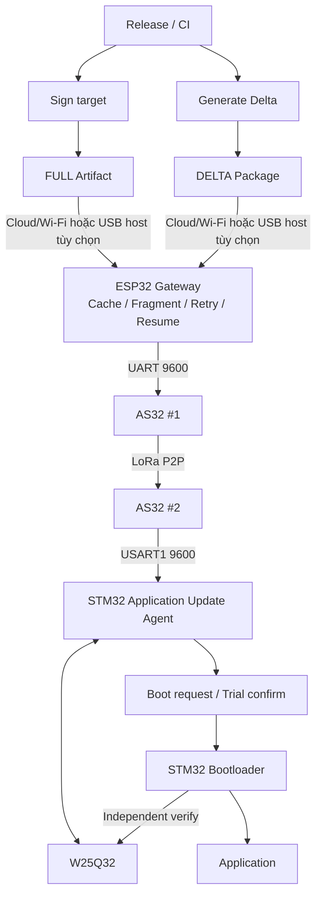
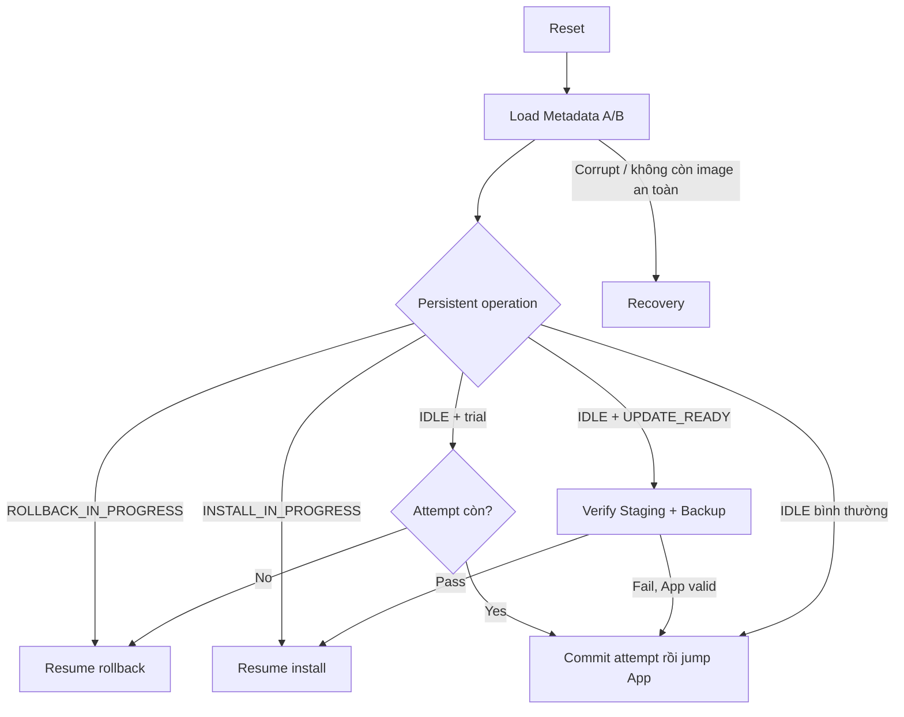

# Architecture — Aegis-OTA P2P

> **Phạm vi (Scope):** Mô tả kiến trúc end-to-end và ownership của từng layer.

> **Tác dụng:** Giúp người đọc thấy đường đi của artifact và ranh giới trách nhiệm giữa các thành phần.


## Release/Transport



## Ownership

| Component | Owns |
|---|---|
| Release/CI | build, sign, Delta generation |
| ESP32 | artifact cache, sender, retry/resume |
| AS32 #1 | Chuyển UART từ ESP32 thành LoRa P2P TX và chuyển LoRa RX ngược về UART |
| AS32 #2 | Chuyển LoRa P2P RX thành UART cho STM32 và chuyển UART response ngược lên radio |
| STM32 Application Update Agent | Gom byte UART, parse/authenticate secure frame, xử lý OTA command, retry/resume và quản lý W25Q32 artifact |
| STM32 Delta applier | Kiểm Delta package/exact base và streaming reconstruct target sang Staging |
| STM32 Bootloader | Đọc manifest, verify target/Backup độc lập, install, trial/rollback và boot decision |
| W25Q32 | Lưu bền vững Staging candidate, Backup App cũ, Delta patch và lịch sử session chống replay |

USART2 PA2/PA3 của STM32 là debug cục bộ tùy chọn ở `115200 8N1`, mặc định
không khởi tạo. Nó không nằm trên đường OTA và không thay ST-Link/SWD Recovery.

## Ý nghĩa của đường RX

`RX` trong sơ đồ không phải một thao tác đơn lẻ “nhận xong rồi nạp firmware”. Dữ
liệu đi qua chuỗi trách nhiệm sau:

```text
AS32 #2 nhận LoRa và xuất UART bytes
 -> Application frame parser tìm đúng một frame
 -> secure transport kiểm CRC/session/counter/TAG và decrypt
 -> OTA receiver kiểm command/transfer/offset/length
 -> storage ghi đúng vùng W25Q32 và read-back
 -> receiver mới phát ACK committed qua đường ngược lại
```

AS32 không hiểu frame, chữ ký, Staging hay firmware version. W25Q32 cũng không tự
nhận dữ liệu; chỉ STM32 mới điều khiển SPI để ghi/đọc chip. Vì thế một packet đã
tới AS32 #2 chưa đồng nghĩa DATA đã được lưu hoặc firmware đã hợp lệ.

Khi Staging và Backup đã sẵn sàng, Application ghi `UPDATE_READY` vào mailbox tồn
tại qua software reset rồi reset MCU. Bootloader consume request, tự verify lại
mọi dữ liệu và chỉ sau đó mới được erase/program Internal Application.

Các mũi tên mô tả đường đi dữ liệu, không trao authority. Application có quyền
chuẩn bị candidate; authority cuối cho verify/install/boot luôn nằm ở Bootloader.

## Luồng điều khiển sau reset


