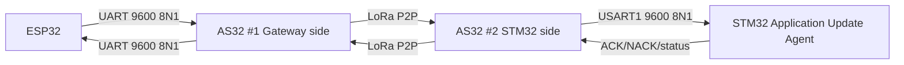

# AS32 LoRa P2P

> **Phạm vi:** Hai AS32-TTL-100-C chạy transparent UART ↔ LoRa P2P ↔ UART.

> **Tác dụng:** Hướng dẫn đấu nối, cấu hình và nghiệm thu liên kết AS32 hai chiều.

> **Bên thực hiện:** ESP32 điều khiển AS32 #1; STM32 Application điều khiển AS32
> #2 qua USART1 và các chân MD0/MD1/AUX. Bootloader không sở hữu link LoRa P2P.

Hardware inventory và các giá trị read-back thật được ghi tại
[LoRa/AS32_Hardware_Profile.md](LoRa/AS32_Hardware_Profile.md).

## Topology



AS32 không parse secure frame hoặc firmware. Nó chỉ chuyển byte; UART packet
boundary không được coi là OTA frame boundary.

## STM32 pin contract

| Signal | STM32 pin | Direction | Tác dụng |
|---|---|---|---|
| AS32 RX / STM32 TX | PA9 / USART1_TX | STM32 → AS32 | STM32 gửi secure frame, command cấu hình và response qua UART. |
| AS32 TX / STM32 RX | PA10 / USART1_RX | AS32 → STM32 | STM32 nhận byte LoRa hoặc phản hồi cấu hình do AS32 đưa ra. |
| MD0 | PB0 | STM32 → AS32 | Cùng MD1 chọn chế độ Normal hoặc Configuration của module. |
| MD1 | PB1 | STM32 → AS32 | Cùng MD0 chọn chế độ Normal hoặc Configuration của module. |
| AUX | PB10 | AS32 → STM32 | Báo trạng thái ready/busy; driver phải chờ bằng timeout hữu hạn. |

AS32 UART baseline là `9600 8N1` ở cả hai đầu. USART2 PA2/PA3 của STM32 chỉ là
debug cục bộ tùy chọn ở `115200 8N1`, mặc định không khởi tạo và không dùng
parser OTA. Python/Cloud đưa artifact tới ESP32 qua network; nếu dùng USB-UART
vào ESP32 thì baud của hop đó độc lập với link AS32.

Mode pins:

```text
Normal transparent mode: MD0=0, MD1=0
Configuration mode:      MD0=1, MD1=1
```

## Command cấu hình dùng trong bring-up

| Command | Response mong đợi | Tác dụng |
|---|---|---|
| C1 C1 C1 | C0 ADDH ADDL SPEED CHAN OPTION | Đọc 5 config byte đang dùng. |
| C0 + 5 config byte | OK, sau đó read-back | Ghi persistent; không tự gọi lúc boot. |
| C2 + 5 config byte | OK, sau đó read-back | Ghi volatile để thử profile. |
| C3 C3 C3 | Response version của module | Ghi nhận đúng model/firmware test. |
| C4 C4 C4 | OK, AUX trở lại ready | Reset module có timeout. |

Bring-up lần đầu chỉ read config/version. Chỉ ghi config sau khi đã xác nhận đúng
model, band, antenna, giới hạn công suất và lưu giá trị cũ.

## Source ownership

| Phía | Source | Làm gì |
|---|---|---|
| STM32 | driver/inc/lora_as32.h, driver/src/lora_as32*.c | USART1, ring RX ISR, MD0/MD1, AUX, config và timeout. |
| ESP32 | esp32_gateway/components/as32/ | UART2, GPIO mode/AUX, config và timeout. |
| ESP32 | esp32_gateway/main/radio_task.* | Queue riêng và phép thử request/echo. |
| Phase 4 test | test/Test_to_Phase/Phase4_LoRa/ | Packet thô, STM32 echo, host regression và evidence. |

Packet Phase 4 gồm MAGIC(2), DIRECTION(1), COUNTER(4), LENGTH(2), PAYLOAD và
CRC32(4). Số nhiều byte dùng little-endian. CRC32 bao phủ từ DIRECTION đến hết
PAYLOAD; MAGIC chỉ dùng resync. Payload candidate là 256 byte, raw packet tối đa
269 byte. Đây chỉ là packet đo link; Phase 5 không được coi nó là secure OTA
frame.

## Driver requirements

- Chờ AUX bằng timeout hữu hạn trước/sau config hoặc transmission operation.
- Read configuration/version, validate response length và read-back sau write.
- Cấu hình hai module cùng channel, UART, air rate, address/profile và TX power.
- Không erase/program W25Q32 hoặc chạy crypto trong UART ISR.
- Ring buffer phải bounded và báo overflow.
- Timeout Phase 4 phải đủ raw packet tối đa 269 byte ở UART 9600 cộng airtime và
  margin. Timeout production Phase 5 phải suy ra lại từ measurement thật.
- Mọi lỗi UART/AUX/config được trả bằng status; không loop vô hạn.

## Electrical requirements

- Logic và nguồn đúng mức 3.3 V theo module/board thực tế.
- ESP32, AS32, STM32 và ST-Link dùng GND chung khi kết nối.
- AUX/MD pins không floating.
- Trước OTA test phải read-back và ghi lại profile của cả hai module.

## Acceptance

- Đọc đúng model/version/config của cả hai AS32.
- Config read-back hai phía giống profile đã khóa.
- Truyền binary hai chiều, gồm byte `0x00`, không chỉ chuỗi ASCII.
- Timeout, disconnect, noise và ring overflow không treo Application.
- Có số đo MTU, RTT, throughput và packet loss; nếu chưa có thì trạng thái vẫn là
  PENDING HARDWARE.
