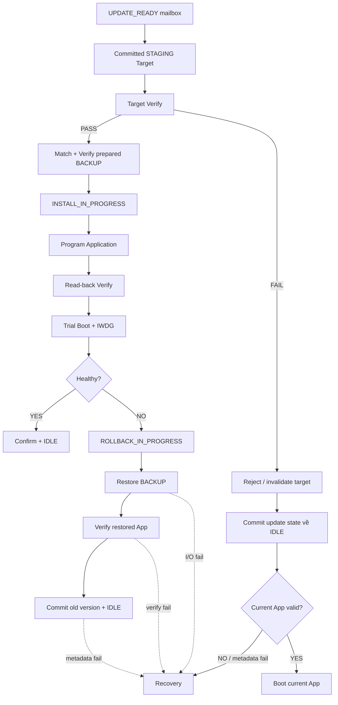

# Boot / Install / Recovery

> **Phạm vi:** Pipeline local sau khi target đã complete trong Staging: validate,
> backup, install, trial, confirm/rollback và điều kiện thật sự phải vào Recovery.

> **Tác dụng:** Hướng dẫn toàn bộ chuỗi xử lý an toàn từ candidate tới boot hoặc phục hồi.

> **Bên thực hiện:** STM32 Application chuẩn bị và kiểm tra sơ bộ Staging/Backup;
> STM32 Bootloader kiểm tra độc lập, ghi Internal Flash, quản lý Trial/Rollback và
> quyết định Recovery. ESP32/AS32 không tham gia các thao tác local này.

## 1. Đầu vào và đầu ra

Pipeline Bootloader bắt đầu sau software reset khi Application Update Agent đã
commit Staging/Backup và ghi `UPDATE_READY`. Đầu vào gồm request identity,
Staging candidate, signed header/signature, metadata active và Backup.

| Kết quả cuối | Ý nghĩa |
|---|---|
| App cũ + `IDLE` | Update bị reject/rollback nhưng thiết bị vẫn an toàn |
| App mới confirmed + `IDLE` | Update hoàn thành |
| Recovery | Không còn image boot được hoặc không thể commit state an toàn |

Recovery không phải kết quả mặc định của mọi lỗi update. Nếu target mới sai nhưng
App hiện tại vẫn hợp lệ, Bootloader bỏ candidate và tiếp tục App cũ.

## 2. Sơ đồ pipeline



## 3. Ý nghĩa từng đoạn

### Target verify

STM32 tự đọc candidate và kiểm format, size, target/version, SHA-512 và Ed25519ph.
Đây là cửa chặn trước mọi thao tác phá hủy. CRC/read-back không thay signature.

### Create Backup

Application Update Agent invalidate manifest cũ, copy App đang chạy sang Backup
Image, read-back toàn bộ, kiểm identity/signature rồi commit Backup manifest bằng
marker ghi cuối. Nếu bước này lỗi, UPDATE_READY không được tạo và Internal App
chưa bị erase. Bootloader luôn verify Backup độc lập sau reset.

### Install

Bootloader chỉ commit `INSTALL_IN_PROGRESS` sau khi request, Staging và Backup đã
verify độc lập, rồi mới erase/program Internal Flash.
Nếu reset, state này khiến boot decision tiếp tục từ verified Staging hoặc chuyển
rollback khi Staging không còn hợp lệ.

Sau khi program và read-back target thành công, Bootloader copy **exact**
SignedHeader/signature đã verify từ Staging manifest vào record Metadata mới,
đặt Trial state rồi commit sang page A/B không active. Raw Application không mang
signature trailer, nên không được xóa cặp này khỏi metadata sau install.

### Trial

Sau program/read-back PASS, Bootloader persist trial flag/attempt trước khi jump.
Application mới chỉ được promote sau self-check + `TRIAL_CONFIRM` mailbox hợp lệ.
Hết attempt hoặc IWDG/reset lặp lại dẫn tới rollback.

### Rollback

Bootloader validate Backup, commit `ROLLBACK_IN_PROGRESS`, restore App cũ và
verify trước khi commit old identity + `IDLE`. Rollback thành công boot App cũ,
không chuyển Recovery.

Old identity được commit gồm exact SignedHeader/signature từ Backup manifest.
Nhờ vậy lần reset kế tiếp Bootloader xác thực App vừa restore trực tiếp từ
Metadata + Internal Application, không cần coi Backup là nguồn identity active.

## 4. Persistent checkpoint bắt buộc

```text
Backup manifest committed
 -> INSTALL_IN_PROGRESS committed
 -> Application programmed + verified
 -> trial state/attempt committed
 -> confirmed + IDLE

hoặc

ROLLBACK_IN_PROGRESS committed
 -> Backup restored + verified
 -> old identity + IDLE
```

Mọi checkpoint dùng Metadata A/B hoặc manifest commit-last. Reset trước/sau mỗi
checkpoint phải chọn được bản cũ hoặc bản mới hoàn chỉnh, không tồn tại half-state.

Target verification diễn ra trước khi erase Application. Vì vậy target mới sai
hash/chữ ký chỉ làm update bị reject; Recovery chỉ dùng khi Application hiện tại
không còn hợp lệ hoặc không thể commit lại metadata an toàn.

## 5. Điều kiện nghiệm thu

- Valid candidate đi hết pipeline và confirm được App mới.
- Invalid candidate giữ nguyên App cũ.
- Reset tại mỗi persistent checkpoint cho outcome xác định.
- Internal/W25Q32 failure không bị bỏ qua và không tạo ACK/install thành công giả.
- Trial failure restore đúng Backup và metadata cuối `IDLE`.
- Chỉ vào Recovery khi App/Backup đều không an toàn hoặc metadata không thể commit.
