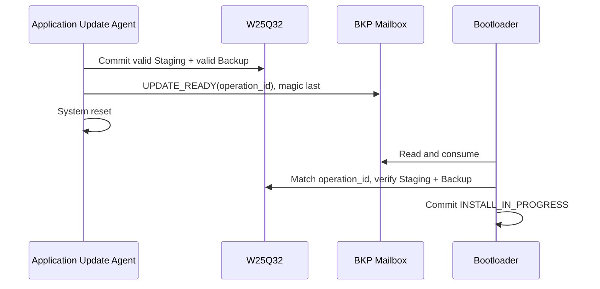
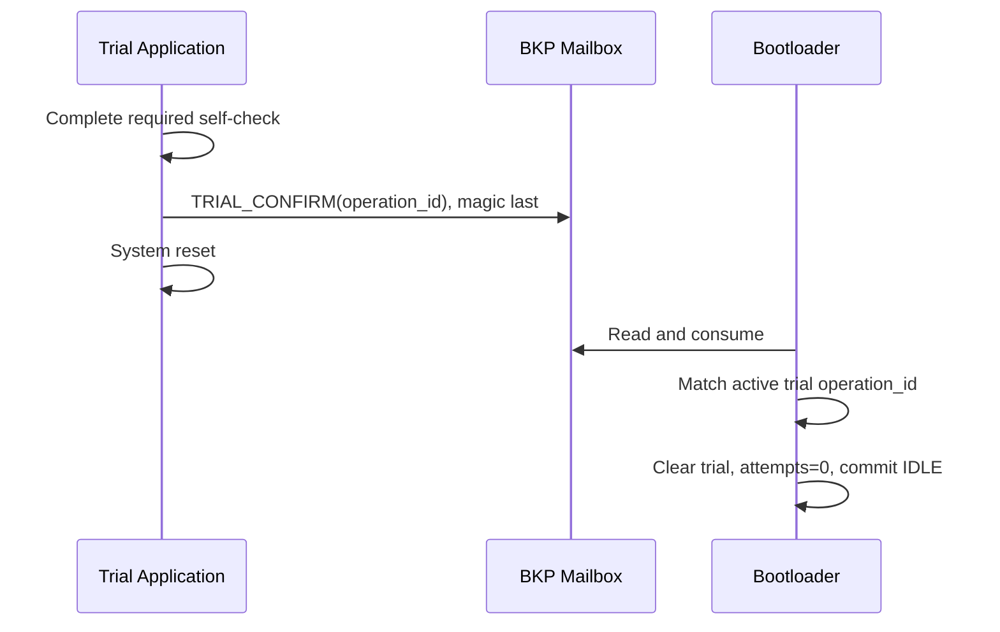

# Boot Request and Trial Confirmation Mailbox

> **Phạm vi:** Reset-surviving ABI để Application yêu cầu Bootloader đánh giá update hoặc confirm trial.

> **Tác dụng:** Quy định cách Application gửi yêu cầu bền qua reset mà không ghi trực tiếp Metadata.

> **Bên thực hiện:** STM32 Application ghi request rồi reset; STM32 Bootloader
> đọc, consume và kiểm tra request. ESP32 chỉ có thể yêu cầu `BOOT` qua App, không
> được ghi mailbox hoặc tạo `TRIAL_CONFIRM` trực tiếp.

## Storage

Mailbox dùng 10 backup registers 16-bit của STM32F103 medium-density, tổng 20
bytes. Nó tồn tại qua software reset nhưng không thay thế W25 manifest hoặc
Metadata A/B.

| Offset | Size | Field | Tác dụng |
|---:|---:|---|---|
| 0 | 4 | Magic/commit value, ghi cuối | Công bố mailbox đã được ghi hoàn chỉnh; thiếu hoặc sai giá trị này thì Bootloader bỏ request. |
| 4 | 2 | Command | Chỉ ra Application đang yêu cầu Bootloader đánh giá update hay xác nhận trial. |
| 6 | 2 | Reserved, phải bằng 0 | Giữ chỗ cho phiên bản sau và giúp phát hiện record không đúng contract hiện tại. |
| 8 | 8 | Operation/candidate ID | Ràng buộc request với đúng transaction/candidate, tránh request cũ tác động lên firmware khác. |
| 16 | 4 | CRC32 bao phủ representation byte `[0, 16)` | Phát hiện mailbox hỏng hoặc bị reset khi đang ghi; CRC không có vai trò xác thực bảo mật. |

Command:

```text
1 = UPDATE_READY
2 = TRIAL_CONFIRM
```

Mọi integer little-endian. Writer invalidate magic trước, ghi command/ID/CRC,
verify rồi ghi magic cuối. Reader copy toàn record, clear magic sớm để request
không lặp vô hạn, sau đó validate magic/reserved/CRC/command/identity.

## UPDATE_READY



Nếu request mất do mất toàn bộ backup-domain power, Internal App vẫn chưa bị
erase. Application khởi động lại, đọc W25 record và có thể tạo lại request.

## TRIAL_CONFIRM



ESP32 không thể tạo TRIAL_CONFIRM qua OTA command. Confirmation API chỉ được gọi
từ Application sau self-check và luôn dẫn qua Bootloader.

## Acceptance

- Reset ở mọi half-word write tạo mailbox cũ hoặc invalid, không tạo command giả.
- Stale/wrong operation ID không install hoặc confirm candidate khác.
- Consumed request không lặp qua reset.
- Mailbox invalid không làm App valid đi Recovery.
