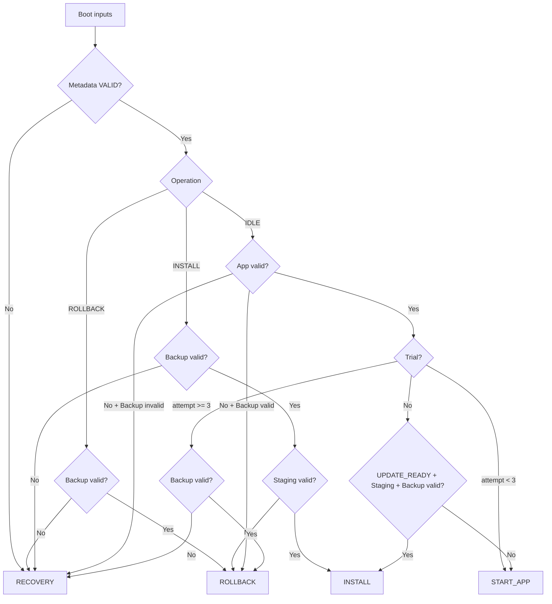

# Boot State Machine

> **Phạm vi:** Hàm quyết định thuần của Bootloader; không thực hiện I/O hoặc đổi state.

> **Tác dụng:** Chốt cách kết hợp các điều kiện đầu vào để chọn đúng boot action.

## State và action

Persistent Internal Flash state:

```text
IDLE
INSTALL_IN_PROGRESS
ROLLBACK_IN_PROGRESS
```

Action tức thời:

| Action | Executor thực hiện |
|---|---|
| `BOOT_ACTION_START_APP` | Validate vector, deinit, relocate VTOR và jump |
| `BOOT_ACTION_INSTALL_UPDATE` | Verify lại artifact, commit state nếu cần và install/resume |
| `BOOT_ACTION_ROLLBACK` | Validate Backup, commit state nếu cần và restore/resume |
| `BOOT_ACTION_RECOVERY` | Giữ Internal App không được boot và vào recovery policy |

Delta receive/apply thuộc Application Update Agent và W25 manifest, không phải
Bootloader action. `FAULT` là event; `RECOVERY` là action/mode, không phải
persistent operation state.

## Input

| Input | Ý nghĩa |
|---|---|
| `metadata_status` | VALID, FIRST_BOOT hoặc CORRUPT |
| `app_valid` | App khớp active metadata và policy xác thực |
| `staging_valid` | Committed target khớp operation/request identity và signature |
| `backup_valid` | Committed Backup khớp transaction/trial predecessor và signature |
| `update_requested` | Mailbox UPDATE_READY hợp lệ và bind đúng candidate |
| `trial_boot` | App hiện tại là candidate chưa confirm |
| `boot_attempt_count` | Số trial jump đã commit |
| `operation_state` | IDLE, INSTALL hoặc ROLLBACK |

Validity booleans được lớp input assembler tính từ manifest, CRC, signature,
identity và range. Decision không được tự giả định “manifest có marker” là đủ.

## Priority

1. `NULL`, FIRST_BOOT chưa provision hoặc metadata CORRUPT → Recovery.
2. ROLLBACK đang dở → tiếp tục nếu Backup valid, ngược lại Recovery.
3. INSTALL đang dở:
   - Staging và Backup valid → Install;
   - Staging invalid nhưng Backup valid → Rollback;
   - không còn Backup → Recovery.
4. State lạ → Recovery.
5. App invalid → Rollback nếu Backup valid, nếu không Recovery.
6. Trial hết ba attempt → Rollback nếu Backup valid, nếu không Recovery.
7. Trial còn attempt → Start App; không nhận update mới.
8. UPDATE_READY + Staging valid + Backup valid → Install.
9. Còn lại → Start App.



## Executor boundary

```c
switch(action){
case BOOT_ACTION_START_APP:
    /* Commit trial attempt if required, then validate and jump. */
    break;
case BOOT_ACTION_INSTALL_UPDATE:
    /* Verify, commit INSTALL_IN_PROGRESS, program and read-back. */
    break;
case BOOT_ACTION_ROLLBACK:
    /* Verify, commit ROLLBACK_IN_PROGRESS, restore and read-back. */
    break;
case BOOT_ACTION_RECOVERY:
default:
    /* Enter the locked recovery policy. */
    break;
}
```

## Acceptance

- Table test bao phủ mọi nhánh và mọi combination nguy hiểm.
- Update sai khi App valid kết thúc bằng Start App, không Recovery.
- Không action nào thay đổi input hoặc gọi Flash/UART/jump.
- Trial chưa được giải quyết không chấp nhận update mới.
- Rollback thành công commit App cũ + IDLE, không chuyển Recovery.
