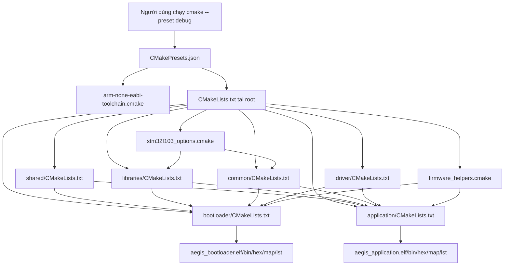
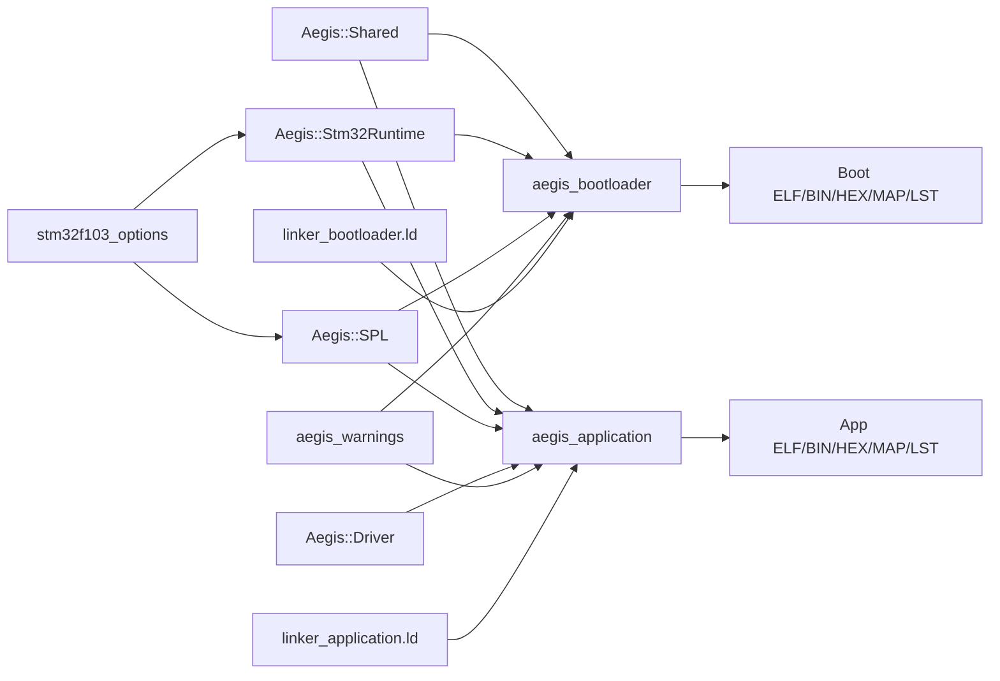

# Quan hệ giữa các file CMake trong project

> **Phạm vi:** Hệ thống build CMake + Ninja dành cho hai firmware STM32F103C8T6: Bootloader và Application.

> **Tác dụng:** Giải thích dân dã mỗi file CMake làm gì, gọi file nào và dữ liệu build đi qua chúng ra sao.

## 1. Hiểu nhanh trong một câu

`CMakePresets.json` chọn cách build; root `CMakeLists.txt` điều phối; các file trong
`cmake/` cung cấp compiler, cờ MCU và công cụ đóng gói; các `CMakeLists.txt` con
tạo thư viện hoặc firmware; cuối cùng Ninja thực hiện lệnh compile, link và sinh
artifact.



## 2. Hai giai đoạn dễ nhầm

### 2.1. Configure: CMake chuẩn bị bản kế hoạch

```bash
cmake --preset debug
```

CMake đọc preset, chọn ARM compiler, đọc toàn bộ `CMakeLists.txt`, kiểm tra đường
dẫn và tạo file điều khiển Ninja trong `build/debug/`. Lúc này source chưa nhất
thiết được biên dịch.

Có thể hiểu đây là lúc người quản lý đọc bản thiết kế rồi lập danh sách việc cần
làm.

### 2.2. Build: Ninja thực hiện bản kế hoạch

```bash
cmake --build --preset debug
```

Ninja gọi compiler cho những source đã thay đổi, gọi linker và chạy các lệnh hậu
xử lý để sinh BIN/HEX. Có thể hiểu Ninja là đội thi công làm theo bản kế hoạch mà
CMake vừa tạo.

## 3. Tác dụng từng file

### 3.1. `CMakePresets.json` — bộ nút bấm có sẵn

File này lưu các lựa chọn thường phải gõ dài trên terminal:

- dùng generator Ninja;
- dùng `cmake/arm-none-eabi-toolchain.cmake`;
- chọn Debug hoặc Release;
- đặt output vào `build/debug/` hoặc `build/release/`;
- khi build thì gọi target tổng `firmware`.

`stm32-base` là preset nền và có `"hidden": true`, nên không chạy trực tiếp. Hai
preset `debug` và `release` kế thừa nó rồi chỉ thay `CMAKE_BUILD_TYPE`.

File JSON không cho phép comment kiểu `//`. Vì vậy ghi chú ngắn được đặt trong
trường chuẩn `description`; ghi chú chung của project nằm trong `vendor` để vẫn
giữ đúng cú pháp mà CMake hiểu.

### 3.2. Root `CMakeLists.txt` — tổng chỉ huy

Đây là entry point chính sau khi toolchain đã được chọn. File này:

1. khai báo project và ngôn ngữ C/Assembly;
2. bắt buộc dùng Ninja và chỉ nhận Debug/Release;
3. nạp hai module `stm32f103_options` và `firmware_helpers`;
4. đi vào từng thư mục con bằng `add_subdirectory()`;
5. gom Bootloader và Application vào các target tổng.

Các target tổng quan trọng:

| Target | Làm gì |
|---|---|
| `firmware` | Build cả Bootloader và Application |
| `size` | In dung lượng của cả hai firmware |
| `disasm` | Sinh file `.lst` của cả hai firmware |
| `flash_bootloader` | Nạp riêng Bootloader bằng OpenOCD |
| `flash_application` | Nạp riêng Application bằng OpenOCD |

Root không tự liệt kê source Bootloader hoặc Application. Mỗi module phải tự sở
hữu danh sách source của mình.

### 3.3. `cmake/arm-none-eabi-toolchain.cmake` — chọn đúng bộ dụng cụ

Máy tính bình thường tạo chương trình chạy trên Linux/Windows. STM32 lại cần mã
máy ARM bare-metal. File toolchain nói với CMake rằng:

- target là ARM bare-metal;
- compiler C và Assembly là `arm-none-eabi-gcc`;
- `ar`, `ranlib`, `objcopy`, `objdump`, `size`, `nm` đều lấy từ ARM GNU Toolchain;
- bước thử compiler chỉ tạo static library, không cố chạy chương trình STM32 trên PC.

File này phải được CMake đọc trước lệnh `project()`, vì không thể đổi compiler an
toàn khi configure đã đi được nửa đường. `CMakePresets.json` đảm bảo đúng thứ tự đó.

### 3.4. `cmake/stm32f103_options.cmake` — túi cấu hình của chip

File này không tạo firmware. Nó tạo hai target `INTERFACE`, tức là những “túi
thuộc tính” không sinh object riêng:

- `stm32f103_options`: Cortex-M3, Thumb, soft-float, C11, đường dẫn CMSIS/SPL,
  macro `STM32F10X_MD`, section GC support, Debug/Release và LTO;
- `aegis_warnings`: `-Wall -Wextra -Werror` cho code production do project viết.

Target nào link các túi này sẽ tự nhận cấu hình, thay vì chép lại cùng một dãy cờ
ở nhiều `CMakeLists.txt`.

### 3.5. `cmake/firmware_helpers.cmake` — khâu đóng gói firmware

File này cung cấp hàm:

```cmake
aegis_configure_firmware(<target> <linker_script>)
```

Bootloader và Application gọi cùng một hàm nhưng truyền linker script khác nhau.
Hàm sẽ:

- kiểm tra target và linker script;
- đặt đuôi output chính là `.elf`;
- truyền linker script và các linker option;
- tạo `.map`;
- dùng `objcopy` sinh `.bin` và `.hex`;
- dùng `size` báo dung lượng;
- dùng `objdump` sinh `.lst`;
- tạo target nạp OpenOCD và connect-under-reset;
- khai báo các file phụ để `ninja clean` dọn đúng.

Phần script mode trong file là cách ghi output của `objdump` thẳng vào `.lst` mà
không phụ thuộc toán tử chuyển hướng `>` của Bash.

### 3.6. `libraries/CMakeLists.txt` — đóng gói thư viện SPL của ST

File này compile các source STM32F10x Standard Peripheral Library thành static
library `aegis_stm32f10x_spl`, có alias dễ đọc là `Aegis::SPL`.

Static library giống một kho object. Khi link, firmware chỉ lấy module có symbol
thực sự được gọi; việc liệt kê đầy đủ SPL không đồng nghĩa toàn bộ SPL bị nhét vào
Flash.

### 3.7. `shared/CMakeLists.txt` — công khai contract dùng chung

File này tạo target header-only `Aegis::Shared`. Nó cung cấp đường dẫn tới các
header như:

- `memory_map.h`;
- `metadata_struct.h`;
- `boot_mailbox.h`;
- `ota_protocol.h`;
- `crypto_config.h`;
- `delta_format.h`.

Nó không compile source. Thư mục `shared/cu/` chỉ là tham khảo và không được
khai báo như source production.

### 3.8. `common/CMakeLists.txt` — phần khởi động chung

File này tạo object library `Aegis::Stm32Runtime`, gồm:

- `startup_stm32f103_md.s`: vector table, `Reset_Handler`, khởi tạo `.data/.bss`;
- `system_stm32f10x.c`: `SystemInit()` và clock runtime của CMSIS.

Object library bảo đảm các object khởi động được đưa trực tiếp vào cả hai ELF.
Bootloader và Application dùng chung implementation nhưng vẫn là hai firmware độc
lập, mỗi firmware có vector table của riêng nó.

File này còn tạo `Aegis::Common` cho logic thuần dùng chung như CRC32,
metadata-record và firmware authentication.

### 3.9. `bootloader/CMakeLists.txt` — tạo Bootloader

File này:

1. liệt kê source thật trong `bootloader/src/`;
2. tạo executable target `aegis_bootloader`;
3. thêm include `bootloader/inc/`;
4. link `Aegis::Shared`, `Aegis::Stm32Runtime`, `Aegis::SPL` và warning policy;
5. gọi helper với `linker_bootloader.ld`.

Source trong `bootloader/Backup/` không tham gia build. Linker đặt vector
Bootloader tại `0x08000000` và giới hạn image trong 16 KB.

### 3.10. `application/CMakeLists.txt` — tạo Application

Cách làm giống Bootloader nhưng tạo target `aegis_application` và dùng
`linker_application.ld`. Linker đặt vector Application tại `0x08004000` và giới
hạn image trong 46 KB.

Hai CMake firmware tách riêng để sau này mỗi bên thêm đúng source theo ownership,
không vô tình kéo receiver/Delta code vào Bootloader.

### 3.11. `driver/CMakeLists.txt` — primitive phần cứng STM32

Target `Aegis::Driver` compile W25Q32, AS32 và timebase. Header public chỉ cung
cấp primitive/status; OTA policy vẫn nằm ở Application hoặc Bootloader theo
ownership. Static linker chỉ kéo object thực sự được firmware gọi.

### 3.12. `esp32_gateway/CMakeLists.txt` — project ESP-IDF riêng

Đây là entry point của ESP-IDF, không phải CMake con của root ARM. Nó tạo
component `as32` và `main`, rồi build bằng `idf.py build`. Không chạy preset
`debug/release` của STM32 cho thư mục này.

## 4. Quan hệ dependency khi link



`target_link_libraries()` ở đây không chỉ mang nghĩa “link thư viện mã máy”. Với
target `INTERFACE`, nó còn truyền include path, macro, compile option và link
option xuống target sử dụng.

## 5. Khi thêm source mới thì sửa file nào?

| Source mới thuộc về | Nơi cần sửa |
|---|---|
| Chỉ Bootloader | `bootloader/CMakeLists.txt` |
| Chỉ Application | `application/CMakeLists.txt` |
| Code C dùng chung hai firmware | tạo/hoàn thiện `common/src`, `common/inc` và cập nhật `common/CMakeLists.txt` |
| Contract/header dùng chung | `shared/`; thường không cần thêm source compile |
| Driver production STM32 | thêm source vào target `Aegis::Driver` trong `driver/CMakeLists.txt` |
| Component ESP32 | CMake/Kconfig trong `esp32_gateway/components/<name>/`; build bằng ESP-IDF |
| Thư viện bên thứ ba | CMake tại thư mục thư viện đó; không chép source vào CMake của firmware |
| Test host/board | CMake trong `test/`; không link mock vào production |

Quy tắc quan trọng: không dùng `file(GLOB ...)` để tự quét toàn bộ `.c`. Liệt kê
source tường minh giúp review biết chính xác code nào đang được đưa vào firmware.

## 6. Các lệnh làm việc thường ngày

```bash
# Chuẩn bị và build Debug
cmake --preset debug
cmake --build --preset debug

# Chuẩn bị và build Release
cmake --preset release
cmake --build --preset release

# Xem dung lượng hoặc sinh disassembly
cmake --build build/debug --target size
cmake --build build/debug --target disasm

# Nạp từng image, chỉ chạy khi board/ST-Link đã kết nối
cmake --build build/debug --target flash_bootloader
cmake --build build/debug --target flash_application

# Xem các target Ninja hiện có
cmake --build build/debug --target help

# Dọn output của profile Debug
cmake --build build/debug --target clean
```

## 7. Tóm tắt cách lần lỗi

Nếu configure lỗi, kiểm tra theo thứ tự:

1. preset có chọn đúng toolchain không;
2. ARM GNU Toolchain và Ninja có trong `PATH` không;
3. root có `add_subdirectory()` đúng tên thư mục không;
4. module con có khai báo đúng source/target không;
5. linker script có tồn tại không.

Nếu compile lỗi, xem source, include, macro và compile option. Nếu link lỗi, xem
linker script, symbol thiếu/trùng và thư viện target. Nếu ELF có nhưng BIN/HEX/LST
không sinh, kiểm tra `objcopy`, `objdump`, `size` và `firmware_helpers.cmake`.
