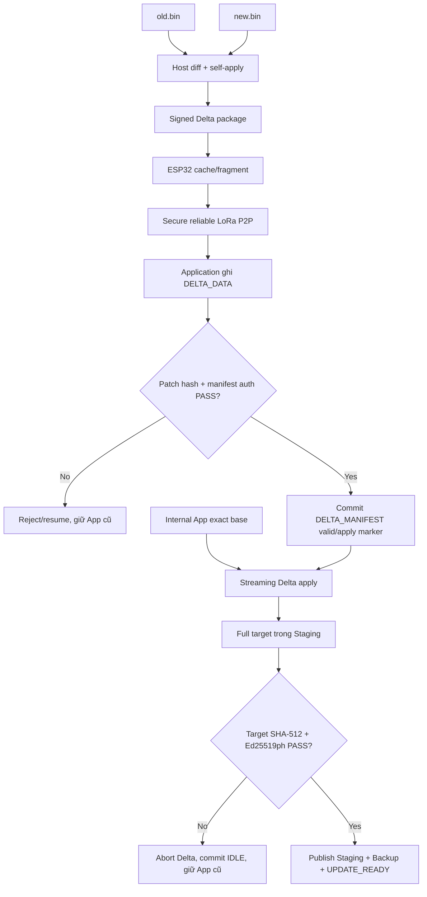

# DELTA OTA

> **Phạm vi:** Host tạo diff; STM32 nhận patch, reconstruct full target sang
> Staging rồi dùng lại pipeline verify/install của FULL OTA.

> **Tác dụng:** Giải thích luồng Delta OTA và cách giảm dữ liệu truyền mà vẫn giữ pipeline an toàn.

## 1. Delta giải quyết vấn đề gì

LoRa P2P có tốc độ thấp nên truyền lại toàn bộ firmware cho mỗi release có thể
tốn nhiều thời gian. Delta chỉ truyền phần khác biệt giữa `old.bin` và `new.bin`.
Đây là optimization băng thông, không phải một đường cài đặt kém an toàn hơn.

Delta chỉ dùng được khi thiết bị đang có **đúng base byte identity** mà package
yêu cầu. Nếu base không khớp hoặc patch không nhỏ hơn FULL theo policy, Gateway
phải dùng signed FULL artifact.

## 2. Ai làm gì

| Thành phần | Trách nhiệm |
|---|---|
| Host/CI | Tìm diff, tạo patch, tự apply kiểm tra, tạo/ký Delta manifest |
| ESP32 | Chọn FULL/Delta theo policy, cache và truyền package |
| STM32 Application Delta receiver | Ghi raw patch vào `DELTA_DATA`, verify rồi commit manifest |
| STM32 Application Delta applier | Đọc exact base + patch, streaming reconstruct sang Staging |
| STM32 Application verifier | Verify sơ bộ full reconstructed target như FULL OTA |
| STM32 Bootloader | Verify target/Backup độc lập rồi install/trial/rollback bằng pipeline chung |

STM32 không chạy thuật toán tìm diff nặng và không tin kết quả self-apply của Host
thay cho việc verify tại thiết bị.

## 3. Luồng end-to-end



## 4. Các checkpoint triển khai

### Host tạo package

Host nhận base, target, target SignedHeader/signature và release private key. Tool
phải:

1. Kiểm kích thước base/target.
2. Tính SHA-512 của base, target và patch.
3. Tạo manifest bind base → target, algorithm/profile và domain
   `AEGIS-F103-DELTA-V1`.
4. Ký Delta manifest bằng Ed25519ph.
5. Tự apply patch và chỉ xuất artifact nếu reconstructed byte-for-byte bằng target.

### Nhận patch

- `BEGIN` loại DELTA invalidate manifest cũ trước khi nhận package mới.
- `DATA` section DELTA chỉ ghi vào `DELTA_DATA` và hỗ trợ duplicate/resume.
- Patch complete chưa đủ valid; STM32 phải tự hash patch và verify manifest.
- Commit marker của Delta manifest được ghi cuối cùng.
- Không erase hoặc dùng Staging trong lúc patch còn tải dở.

### Kiểm exact base

Trước apply, STM32 kiểm đồng thời base version/size theo metadata và tự tính
SHA-512 trên đúng `base_size` byte của Internal Application. Chỉ metadata match
không đủ vì byte firmware có thể đã hỏng.

### Reconstruct target

Applier dùng buffer nhỏ, không malloc theo image size:

```text
base reader  = Internal Application
patch reader = W25Q32 DELTA_DATA
output writer = W25Q32 STAGING
```

Tất cả offset/length/opcode phải fail-closed. Applier không được program
Application và không được coi Delta manifest signature là target signature.

### Verify và install

Sau reconstruct, Application tính target SHA-512, kiểm SignedHeader/version và
Ed25519ph target signature rồi publish Staging. Nó tạo Backup, ghi UPDATE_READY và
reset. Bootloader tự verify lại Staging/Backup, commit `INSTALL_IN_PROGRESS` rồi
reuse FULL install/trial/rollback.

## 5. Reset và fallback

- Reset khi đang nhận patch: resume từ persistent Delta receive state hoặc nhận
  lại; manifest chưa commit vẫn invalid.
- Reset khi đang apply: Application đọc apply marker; nếu manifest/patch/base còn
  valid thì erase Staging và reconstruct từ đầu.
- Manifest/patch/base invalid sau reset: invalidate Delta/Staging record và giữ
  App cũ; Internal metadata vẫn `IDLE`.
- Delta target verify fail: không install; dùng FULL cho lần update tiếp theo.

Không patch Application in-place. Nhờ đó old App còn nguyên trong toàn bộ bước
receive/reconstruct/verify và vẫn boot được nếu Delta thất bại.

## 6. Điều kiện nghiệm thu

- Exact base + valid patch tạo target byte-for-byte giống Host.
- Wrong base version/size/hash đều bị từ chối trước apply.
- Corrupt/truncated/malformed patch không ghi ra ngoài Staging.
- Reconstructed target sai hash/signature không chuyển sang install.
- Reset giữa receive và apply cho kết quả deterministic, không loop vô hạn.
- FULL fallback luôn được phát hành và hoạt động độc lập với Delta.
- Số byte/thời gian/radio cost Delta được đo trên cùng dataset FULL; chỉ dùng
  Delta khi lợi ích thực tế đủ bù code-size/RAM/recovery complexity.
