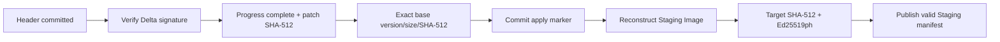

# Delta Package Format

> **Phạm vi:** Byte contract của Delta manifest nằm trong sector 4 KB đầu Delta Area.

> **Tác dụng:** Khóa layout để Python, ESP32 và STM32 đọc/ghi Delta package giống nhau.

> **Bên thực hiện:** Tool Release/CI tạo và ký package; ESP32 chỉ vận chuyển;
> STM32 Application nhận, kiểm tra và apply Delta sang Staging; Bootloader chỉ
> xác thực và cài **full target** đã reconstruct, không chạy patch engine.

## Immutable signed body

| Offset | Size | Field | Tác dụng |
|---:|---:|---|---|
| 0 | 20 | Domain field: 19 byte ASCII `AEGIS-F103-DELTA-V1` + một byte `0` | Tách chữ ký Delta khỏi các loại artifact hoặc project khác, tránh dùng nhầm chữ ký giữa các domain. |
| 20 | 4 | Format version | Cho biết phiên bản layout để parser từ chối package không tương thích. |
| 24 | 4 | Patch algorithm/profile ID | Chọn đúng thuật toán và bộ quy tắc opcode mà Delta applier phải dùng. |
| 28 | 8 | Delta artifact ID | Nhận diện duy nhất package Delta trong lúc truyền, lưu trữ và resume. |
| 36 | 4 | Base firmware version | Yêu cầu đúng phiên bản App gốc trước khi apply patch. |
| 40 | 4 | Base firmware size | Khóa phạm vi byte của App gốc và ngăn đọc vượt vùng hợp lệ. |
| 44 | 64 | Base SHA-512 | Chứng minh Internal App hiện tại đúng chính xác base mà patch được tạo từ đó. |
| 108 | 32 | Target SignedHeader | Mô tả firmware đích: domain, format, kích thước, version và CRC32. |
| 140 | 64 | Target SHA-512 | Kiểm tra Staging Image sau reconstruct giống chính xác firmware đích. |
| 204 | 64 | Target Ed25519ph signature | Cho phép Application và Bootloader xác thực nguồn gốc firmware đích sau reconstruct. |
| 268 | 4 | Patch size | Giới hạn vùng patch cần nhận/đọc và dùng để tính số fragment. |
| 272 | 64 | Patch SHA-512 | Phát hiện patch thiếu hoặc sai byte trước khi chạy Delta applier. |

Các integer dùng little-endian. Immutable body dài đúng **336 bytes**.

`artifact_id` là 8 byte đầu của
`SHA-512(base_sha512 || target_sha512 || patch_sha512)`. Đây là identity gọn để
bind transfer/resume; ba digest 64 byte và chữ ký mới là bằng chứng toàn vẹn/xác
thực, không dùng artifact ID thay cho verify crypto.

Delta manifest signature:

```text
SHA-512(immutable_body[336])
 -> Ed25519ph delta_signature[64]
```

## Persistent control record

File phát hành `.aegisdelta` chứa `immutable_body[336] || delta_signature[64]
|| patch`. Khi mở một transfer, `tools/package_transfer.py` ghép operation ID,
transfer ID, progress và marker để tạo persistent `Delta_Manifest_t` 656 byte.
Các field transaction/progress không nằm trong package immutable vì chúng thay
đổi theo từng lần gửi và từng node.

| Offset | Size | Field | Tác dụng |
|---:|---:|---|---|
| 336 | 64 | Delta manifest Ed25519ph signature | Xác thực immutable body và các identity/hash bên trong trước khi tin package Delta. |
| 400 | 8 | Operation ID | Liên kết cùng một lần update qua Delta, Staging, Backup, mailbox và Metadata. |
| 408 | 8 | Transfer ID | Nhận diện đúng phiên truyền để resume hoặc từ chối DATA thuộc phiên cũ. |
| 416 | 2 | Data chunk size, baseline 224 bytes | Quy định kích thước mỗi block DATA và cách ánh xạ offset sang progress bitmap. |
| 418 | 2 | Fragment count, tối đa 1152 | Cho biết có bao nhiêu block phải commit trước khi package được coi là nhận đủ. |
| 420 | 4 | Record CRC32, bao phủ byte `[0, 420)` | Phát hiện phần header/control bị hỏng hoặc ghi dở; không thay thế chữ ký. |
| 424 | 4 | Header commit marker | Công bố header nhận đã persist hoàn chỉnh và transfer có thể resume. |
| 428 | 4 | Artifact-valid commit marker | Công bố patch đã nhận đủ, hash đúng và chữ ký Delta hợp lệ. |
| 432 | 4 | Apply-started marker | Ghi nhớ quá trình reconstruct đã bắt đầu; sau reset phải dựng lại Staging từ đầu. |
| 436 | 76 | Reserved, giữ erased `0xFF` | Giữ không gian cho format sau và hỗ trợ phát hiện dữ liệu không đúng contract. |
| 512 | 1152 bits / 144 bytes | Receive progress bitmap | Mỗi bit theo dõi một data chunk: `1` là chưa commit, `0` là đã program và read-back thành công. |

Persistent record dùng đến offset 656; phần còn lại của sector 4 KB giữ erased.
`fragment_count = ceil(patch_size / chunk_size)` và phải nằm trong `1..1152`.
Giá trị khóa: format `1`, header marker `0x44484431`, artifact-valid marker
`0x44564C31`, apply-started marker `0x44415031`; erased marker là `0xFFFFFFFF`.

Các byte còn lại trong sector 4 KB phải erased hoặc bằng giá trị reserved đã
được format version quy định. Marker được program theo hướng `0xFFFFFFFF` sang
giá trị commit; không ghi ngược bit từ `0` lên `1` nếu chưa erase sector.

Ý nghĩa:

- Header marker: identity và thông tin transfer đã persist, có thể resume.
- Progress bitmap: block đã program và read-back thành công.
- Artifact marker: patch đã nhận đủ, hash đúng và Delta signature hợp lệ.
- Apply marker: Application đã bắt đầu reconstruct; sau reset phải erase Staging
  Image và reconstruct lại từ committed Delta package.

## Validation order



Delta signature không thay thế target signature. Bootloader chỉ cài full target
từ Staging sau khi tự verify target SignedHeader và target signature.

## Acceptance

- Static assert khóa mọi offset, kích thước và giới hạn fragment.
- Python/C golden vector serialize giống nhau.
- Wrong base, patch hash, Delta signature hoặc target signature đều fail-closed.
- Reset lúc receive resume từ bitmap; reset lúc apply reconstruct lại từ đầu.
