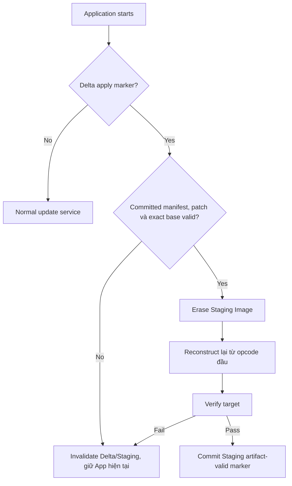

# Delta Streaming Applier

> **Phạm vi:** Bounded-memory Delta apply trong STM32 Application Update Agent.

> **Tác dụng:** Hướng dẫn reconstruct target theo luồng mà không cần chứa toàn bộ image trong SRAM.

> **Bên thực hiện:** Chỉ STM32 Application Update Agent chạy patch engine.
> Release/CI tạo patch; ESP32/AS32 vận chuyển; Bootloader không apply Delta.

## Ownership và I/O

```text
base reader   = Internal Application, read-only
patch reader  = W25Q32 DELTA_DATA
target writer = W25Q32 STAGING_IMAGE
```

Applier không erase/program Internal Application và không ghi Metadata A/B.
Bootloader chỉ nhìn thấy full target đã được publish vào Staging.

## Baseline patch VM

```text
COPY(base_offset, length)
ADD(length, literal_bytes)
END
```

Yêu cầu:

- buffer cố định 128 hoặc 224 bytes;
- không malloc theo image size;
- mọi offset/length chống overflow;
- COPY không vượt exact base size;
- ADD không vượt patch hoặc target size;
- đúng một END tại target size;
- trailing opcode/data bị từ chối;
- mọi W25 write có read-back/status.

## Reset policy



Không persist opcode giữa chừng. App hiện tại còn nguyên nên reset giữa apply chỉ
làm mất phần Staging đang tạo; lần sau reconstruct lại từ đầu.

## Acceptance

- Exact base + valid patch tạo target byte-for-byte.
- Malformed/truncated/overflow opcode fail-closed và không vượt Staging.
- Reset tại mọi output block reconstruct lại được từ đầu.
- Target chỉ được publish sau SHA-512 + Ed25519ph PASS.
