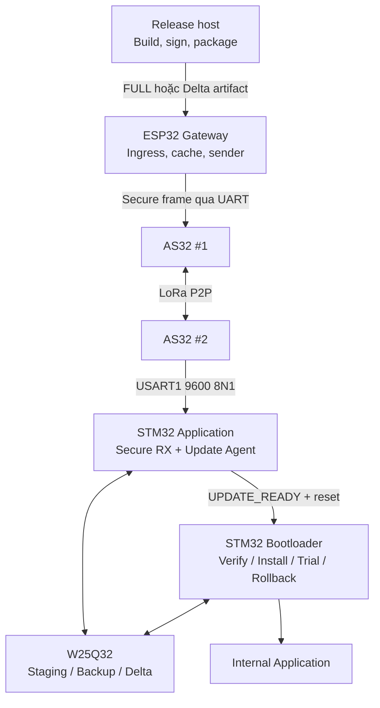
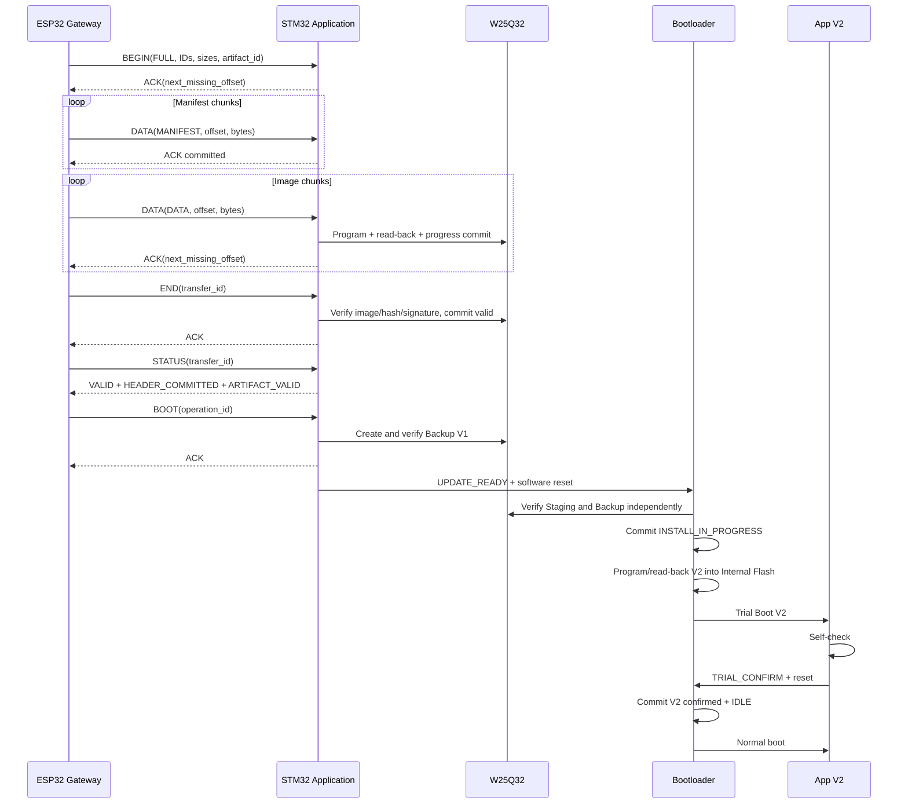
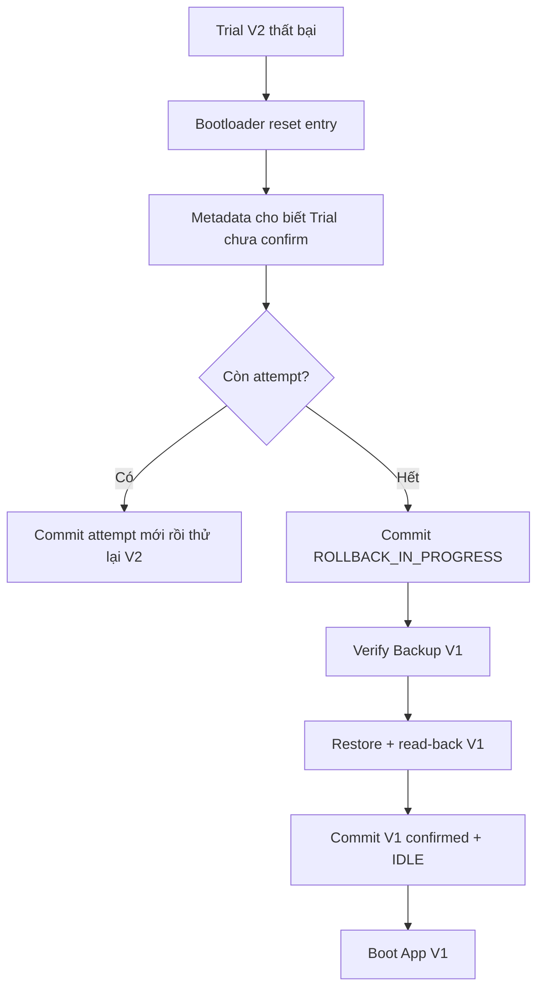

# Hướng dẫn chạy Aegis-OTA end-to-end

> **Tác dụng:** Hướng dẫn vận hành toàn bộ hệ thống từ build, ký và nạp firmware
> ban đầu đến lúc ESP32 nhận artifact, gửi `BEGIN/DATA/END/BOOT`, STM32 cài đặt,
> Trial Confirm, retry/resume khi mất gói và rollback khi firmware mới lỗi.

> **Phạm vi:** Quy trình production đích của Aegis-OTA LoRa P2P với ESP32,
> hai AS32-TTL-100-C, STM32F103C8T6, W25Q32 và ST-Link.

> **Giả định của runbook:** Tất cả Phase đã PASS; key đã được provision an toàn;
> ESP32 ingress/cache, hai AS32, W25Q32, timeout/retry profile và số liệu RF đã
> được nghiệm thu. Vì vậy file này mô tả cách hệ thống hoàn chỉnh được chạy,
> không mô tả lại các bước còn dang dở của quá trình phát triển.

## 1. Hệ thống dùng trong một lần cập nhật



Các vai trò không được thay đổi khi vận hành:

- Release host giữ private signing key và tạo artifact.
- ESP32 cache artifact, chia nhỏ, retry/resume và theo dõi tiến độ.
- AS32 chỉ chuyển byte; không xác thực firmware.
- STM32 Application nhận và chuẩn bị artifact trong W25Q32.
- Bootloader tự xác thực lại và giữ quyền cuối cho install/boot/rollback.

## 2. Điều kiện trước khi chạy

### 2.1. Phần mềm trên máy Release

```bash
arm-none-eabi-gcc --version
cmake --version
ninja --version
openocd --version
python3 --version
```

Máy Release phải có:

- ARM GNU Toolchain, CMake, Ninja và OpenOCD;
- Python 3 và host compiler `cc` cho signer;
- ESP-IDF đúng version đã khóa cho ESP32;
- release private seed nằm ngoài repository và chỉ owner đọc được;
- thư mục evidence có quyền truy cập phù hợp.

### 2.2. Phần cứng

- STM32F103C8T6, W25Q32 và AS32 #2 đã đấu theo
  [hardware-connection-diagram.md](hardware-connection-diagram.md).
- ESP32 và AS32 #1 đã đấu đúng pin/profile.
- Hai AS32 đã gắn antenna đúng band và read-back cùng profile.
- ST-Link nối `SWDIO`, `SWCLK`, `NRST`, `GND` và nhận đúng target voltage.
- Release public key trong STM32 khớp private key dùng để ký.
- ESP32 và STM32 Application giữ cùng transport key của đúng device.
- Mỗi lần khởi tạo phiên truyền dùng một `SESSION_ID` mới, không được reuse.

## 3. Chạy regression trước khi phát hành

Từ root repository:

```bash
./scripts/check_all.sh
```

Chỉ tiếp tục khi build Debug/Release, host regression, size gate và crypto test
đều PASS. Một regression thất bại phải dừng release; không bỏ qua để thử trực
tiếp trên thiết bị.

## 4. Build firmware STM32

```bash
cmake --preset release
cmake --build --preset release
cmake --build build/release --target size disasm
```

Các output chính:

```text
build/release/bootloader/aegis_bootloader.elf
build/release/bootloader/aegis_bootloader.bin
build/release/application/aegis_application.elf
build/release/application/aegis_application.bin
```

Trước khi phát hành phải kiểm:

- Bootloader không vượt partition 16 KB;
- Application không vượt partition 46 KB;
- linker map không lấn Metadata A/B;
- firmware không chứa private signing key;
- weak zero-value device key đã được thay bằng provisioning source an toàn.

## 5. Provision và nạp thiết bị lần đầu

Phần này chỉ chạy khi sản xuất thiết bị mới hoặc recovery bằng ST-Link.

### 5.1. Tạo signed artifact của App nền V1

Checkout/tag đúng source V1, build Release rồi giữ nguyên binary đó làm factory
image và exact base cho Delta về sau:

```bash
mkdir -p dist/factory
cp build/release/application/aegis_application.bin \
  dist/factory/application-v1.bin
chmod 600 /secure/release_seed.hex

python3 tools/sign_firmware.py \
  --bin dist/factory/application-v1.bin \
  --version 1 \
  --private-key /secure/release_seed.hex \
  --output dist/factory/application-v1.aegisfw \
  --public-key-output dist/factory/release_public_key.bin
```

`application-v1.bin` phải là đúng binary được link tại `0x08004000`. Public key
đầu ra phải khớp key đã provision/compile vào firmware STM32.

### 5.2. Tạo Metadata factory cho App V1

```bash
python3 tools/make_factory_metadata.py \
  --artifact dist/factory/application-v1.aegisfw \
  --public-key dist/factory/release_public_key.bin \
  --output-a dist/factory/metadata-a.bin \
  --output-b dist/factory/metadata-b.bin
```

Metadata A mô tả App V1 đã được xác thực; Metadata B ở trạng thái erased để lần
commit tiếp theo có page đích an toàn.

### 5.3. Kiểm lệnh rồi nạp factory bundle

Dry-run trước:

```bash
python3 tools/recovery_tool.py \
  --bootloader build/release/bootloader/aegis_bootloader.bin \
  --application dist/factory/application-v1.bin \
  --metadata-a dist/factory/metadata-a.bin \
  --metadata-b dist/factory/metadata-b.bin
```

Sau khi kiểm đúng board và đúng đường dẫn, thực thi:

```bash
python3 tools/recovery_tool.py \
  --bootloader build/release/bootloader/aegis_bootloader.bin \
  --application dist/factory/application-v1.bin \
  --metadata-a dist/factory/metadata-a.bin \
  --metadata-b dist/factory/metadata-b.bin \
  --execute
```

Tool dùng connect-under-reset, nạp và verify bốn vùng:

| Dữ liệu | Địa chỉ |
|---|---|
| Bootloader | `0x08000000` |
| Application V1 | `0x08004000` |
| Metadata A | `0x0800F800` |
| Metadata B | `0x0800FC00` |

Sau reset, App V1 phải chạy ở trạng thái confirmed + `IDLE`.

## 6. Build và nạp ESP32 Gateway

Trong terminal đã export ESP-IDF:

```bash
cd esp32_gateway
idf.py set-target esp32
idf.py build
idf.py -p /dev/ttyUSB0 flash monitor
```

Thay `/dev/ttyUSB0` bằng đúng cổng thật. Bản production phải nạp:

- transport key/device identity tương ứng STM32;
- AS32 GPIO/UART profile đã nghiệm thu;
- ingress để nhận artifact từ PC/Cloud;
- persistent cache cho manifest/data;
- generator `SESSION_ID` mới và persistent TX state cần thiết.

Khi boot, ESP32 phải đọc và log AS32 model/config/version, chuyển module sang
Normal mode, sau đó mới công bố Gateway sẵn sàng nhận artifact.

## 7. Tạo FULL release V2

### 7.1. Ký target mới

```bash
mkdir -p dist/v2

python3 tools/sign_firmware.py \
  --bin build/release/application/aegis_application.bin \
  --version 2 \
  --private-key /secure/release_seed.hex \
  --output dist/v2/application-v2.aegisfw \
  --public-key-output dist/v2/release_public_key.bin
```

### 7.2. Đóng gói cho sender của ESP32

```bash
python3 tools/package_transfer.py \
  --artifact dist/v2/application-v2.aegisfw \
  --operation-id 0x1002 \
  --transfer-id 0x2002 \
  --output-prefix dist/v2/full-v2
```

Output:

```text
dist/v2/full-v2.manifest.bin
dist/v2/full-v2.data.bin
```

`operation_id`, `transfer_id` và artifact identity phải được giữ nguyên trong
mọi lần retry/resume của cùng transaction. Một transaction mới phải dùng ID mới.

## 8. ESP32 nhận và cache artifact

Ingress production nhận hai file package cùng metadata điều khiển sau:

```text
artifact_type = FULL
operation_id  = 0x1002
transfer_id   = 0x2002
manifest      = full-v2.manifest.bin
data          = full-v2.data.bin
chunk_size    = 224
```

Ingress cụ thể có thể là HTTPS, MQTT, Wi-Fi local hoặc USB host, nhưng trước khi
báo “READY” ESP32 phải:

1. nhận đủ manifest và data vào persistent cache;
2. kiểm size, loại artifact và identity;
3. tính/check hash hoặc CRC thuộc package contract;
4. không sửa byte artifact trong lúc gửi;
5. tạo `SESSION_ID` ngẫu nhiên mới;
6. tạo `OtaSender_Artifact_t` trỏ vào cache ổn định;
7. gọi `OtaGateway_Init()` rồi `OtaGateway_SendArtifact()`.

`OtaGateway_SendArtifact()` là entry point cuối của sender. Caller không tự gửi
rời từng UART packet và không bỏ qua secure-frame layer.

## 9. Luồng FULL OTA bình thường



### 9.1. Ý nghĩa từng command

| Command | Bên gửi | Khi nào được ACK |
|---|---|---|
| `BEGIN` | ESP32 | Transfer hợp lệ được tạo hoặc transaction cùng identity được nối lại. |
| `DATA(MANIFEST)` | ESP32 | Chunk manifest đúng offset được nhận; khi đủ manifest, storage được chuẩn bị an toàn. |
| `DATA(DATA)` | ESP32 | Data đã program/read-back và progress tương ứng đã commit bền vững. |
| `END` | ESP32 | Artifact đã nhận đủ và vượt qua validation của Application. |
| `STATUS` | ESP32 | STM32 trả persistent state thật từ W25Q32/Metadata. |
| `BOOT` | ESP32 | Backup và điều kiện request đã hợp lệ; ACK không thay quyền verify của Bootloader. |

Sau `BOOT`, ESP32 không gửi `TRIAL_CONFIRM`. Chỉ chính App V2 sau self-check mới
được gửi mailbox confirm cho Bootloader.

## 10. Khi mất gói hoặc mất ACK

Sender dùng stop-and-wait: mỗi request chỉ chuyển sang bước kế khi nhận đúng
response có session, sequence, transfer và authentication hợp lệ.

### 10.1. Mất gói DATA trên đường ESP32 → STM32

```text
ESP32 gửi DATA(offset=N)
    ↓ mất gói
Không có ACK trước timeout
    ↓
ESP32 retry cùng logical DATA/sequence bằng secure frame mới
    ↓
STM32 nhận, ghi/read-back/commit progress
    ↓
ACK(next_missing_offset)
```

Retry dùng frame counter mới để không reuse nonce, nhưng logical request vẫn có
cùng `transfer_id`, section, offset và bytes.

### 10.2. DATA đã commit nhưng ACK bị mất

```text
STM32 đã ghi DATA và commit progress
    ↓ ACK bị mất
ESP32 timeout rồi gửi lại DATA cùng offset/bytes
    ↓
STM32 nhận diện duplicate giống hệt
    ↓
Không ghi dữ liệu khác, trả lại ACK tiến độ hiện tại
```

Duplicate có cùng offset nhưng bytes khác phải bị từ chối bằng NACK; không được
coi là retry hợp lệ.

### 10.3. Hết số lần retry

Gateway dừng transaction ở phía gửi, giữ nguyên artifact cache và báo lỗi
`RETRY_EXHAUSTED`. Nó không phát `BOOT` và không xóa state W25Q32. Operator sửa
nguồn/radio/profile rồi thực hiện resume.

## 11. Resume sau mất link hoặc reset

### 11.1. ESP32 reset

1. ESP32 không reuse session/counter cũ.
2. Tạo `SESSION_ID` mới.
3. Load lại immutable artifact từ cache.
4. Gửi `STATUS` hoặc `BEGIN` với đúng transfer/artifact/operation identity.
5. STM32 trả `next_missing_offset` từ progress đã commit trong W25Q32.
6. ESP32 tiếp tục từ offset đó, không gửi lại toàn bộ data nếu không cần.

### 11.2. STM32 reset trong lúc receive

Bootloader thấy không có `UPDATE_READY` hợp lệ nên boot lại App cũ. Application
load manifest/progress từ W25Q32; Gateway query rồi tiếp tục từ chunk còn thiếu.

### 11.3. Mất nguồn khi ghi manifest/data

- Body chưa có commit marker hợp lệ không được sử dụng.
- ACK chỉ được gửi sau program/read-back/progress commit.
- Sau cấp nguồn lại, record committed gần nhất là source of truth.
- Artifact chưa hoàn chỉnh không được chuyển sang `BOOT`.

## 12. Trial Boot thành công

App V2 chạy self-check tối thiểu:

- clock/runtime hợp lệ;
- transport key đã provision;
- AS32 init được;
- W25Q32 init/JEDEC hợp lệ;
- Update Agent khởi tạo được;
- operation ID của Trial khớp Metadata.

Khi healthy, App V2 ghi `TRIAL_CONFIRM` commit-last vào mailbox rồi reset. Sau
reset, Bootloader kiểm request, commit Metadata thành V2 confirmed + `IDLE`, sau
đó boot V2 bình thường.

Điều kiện PASS cuối:

```text
Active App version = 2
Active App hash    = hash V2
Metadata state     = IDLE
Trial flag         = false
Boot attempt       = 0
Mailbox            = consumed/cleared
```

## 13. Trial thất bại và rollback

Nếu V2 treo, watchdog reset, self-check fail hoặc không confirm trong số attempt
cho phép:



Rollback PASS khi App V1 được restore đúng hash/signature và Metadata trở về
`IDLE`. Recovery chỉ được dùng nếu cả App, Staging và Backup đều không tạo được
một đường boot/restore an toàn.

## 14. Chạy Delta OTA V1 → V2

### 14.1. Tạo package Delta

```bash
python3 tools/make_delta.py \
  --base dist/factory/application-v1.bin \
  --base-version 1 \
  --target-artifact dist/v2/application-v2.aegisfw \
  --private-key /secure/release_seed.hex \
  --output dist/v2/v1-to-v2.aegisdelta

python3 tools/package_transfer.py \
  --artifact dist/v2/v1-to-v2.aegisdelta \
  --operation-id 0x1003 \
  --transfer-id 0x2003 \
  --output-prefix dist/v2/delta-v1-to-v2
```

### 14.2. Luồng Delta

```text
ESP32 cache Delta manifest + patch
 -> BEGIN(DELTA)
 -> DATA manifest
 -> DATA patch với ACK/retry/resume
 -> END
 -> Application verify Delta manifest + patch hash/signature
 -> kiểm exact base V1 bằng byte Internal Application thật
 -> streaming COPY/ADD/END
 -> reconstruct V2 sang W25Q32 Staging
 -> verify target V2 như FULL
 -> STATUS
 -> BOOT
 -> Bootloader install/trial/confirm giống hệt FULL
```

Delta không patch trực tiếp App V1. Nếu exact base không khớp, patch malformed,
truncated hoặc reconstructed target không verify được, transaction bị từ chối và
Gateway chọn signed FULL artifact V2 làm fallback.

## 15. Theo dõi trạng thái từ Gateway

Gateway dùng `STATUS` thay vì suy đoán theo RAM riêng. Các mốc quan trọng:

| State/flag | Ý nghĩa vận hành |
|---|---|
| `IN_PROGRESS` | Đang nhận; dùng `next_missing_offset` để tiếp tục. |
| `HEADER_COMMITTED` | Manifest header đã được ghi bền vững. |
| `ARTIFACT_VALID` | FULL/Delta nhận đủ và đã vượt validation tương ứng. |
| `STAGING_READY` | Target firmware hoàn chỉnh đã có trong Staging. |
| `BACKUP_VALID` | App cũ đã có Backup hợp lệ. |
| `INSTALLED` | Target identity đang nằm trong Internal Application. |
| `CONFIRMED` | Target đã qua Trial và Metadata ổn định ở `IDLE`. |
| `INVALID` | Transaction không được tiếp tục; xem NACK/evidence để xử lý. |

Một UI/CLI production chỉ được báo “Update complete” khi thấy `CONFIRMED`, không
phải ngay sau `END`, `BOOT` hoặc khi radio gửi hết byte.

## 16. Kết quả cuối hợp lệ

Sau bất kỳ update hoặc fault nào, thiết bị chỉ được kết thúc ở một trong ba trạng
thái:

```text
A. App cũ hợp lệ + Metadata IDLE
B. App mới verified, confirmed + Metadata IDLE
C. Recovery vì không còn image an toàn
```

Không hợp lệ nếu:

- boot image chưa verify;
- Metadata/manifest nửa commit;
- loop reset vô hạn;
- App mới chạy nhưng bị báo confirmed khi chưa self-check;
- ESP32 báo thành công chỉ vì đã gửi hết packet;
- retry dùng lại nonce/counter của session cũ;
- Delta ghi trực tiếp vào Internal Application.

## 17. Evidence phải lưu cho mỗi lần release

```text
evidence/<release-id>/
├── toolchain-versions.txt
├── build-size.txt
├── bootloader.elf
├── bootloader.map
├── application.elf
├── application.map
├── application-v2.aegisfw
├── v1-to-v2.aegisdelta
├── release-manifest.json
├── as32-profile.txt
├── gateway.log
├── stm32.log
├── full-result.txt
├── delta-result.txt
├── fault-results.txt
└── rf-metrics.csv
```

Tạo release manifest mẫu:

```bash
python3 tools/create_release_manifest.py \
  --release-version v2 \
  --artifact dist/v2/application-v2.aegisfw \
  --artifact dist/v2/v1-to-v2.aegisdelta \
  --artifact build/release/bootloader/aegis_bootloader.elf \
  --artifact build/release/application/aegis_application.elf \
  --output dist/v2/release-v2-evidence.json
```

Không lưu private seed, transport key hoặc plaintext secret trong log/evidence.

## 18. Quy trình rút gọn cho operator

```text
1. Chọn đúng device và đọc STATUS hiện tại.
2. Chọn DELTA nếu exact base match và policy cho phép; nếu không chọn FULL.
3. Upload artifact vào persistent cache của ESP32.
4. ESP32 tạo session mới và gửi BEGIN.
5. Theo dõi DATA ACK, retry và next_missing_offset.
6. END; chờ ARTIFACT_VALID và STAGING_READY.
7. BOOT; thiết bị reset để Bootloader verify/install.
8. Chờ Trial self-check và CONFIRMED.
9. Đọc lại active version/hash + Metadata IDLE.
10. Lưu log, RF metric và release evidence.
```

Nếu mất link ở bước 4–6, giữ nguyên artifact và resume theo trạng thái STM32.
Nếu mất nguồn ở bước 7–8, cấp nguồn lại để Bootloader tiếp tục transaction hoặc
rollback. Không dùng ST-Link can thiệp giữa transaction trừ khi thiết bị đã vào
Recovery và không còn đường tự phục hồi.

## 19. Tài liệu liên quan

- [hardware-connection-diagram.md](hardware-connection-diagram.md): đấu nối toàn bộ phần cứng.
- [release-and-artifact.md](release-and-artifact.md): tạo FULL/Delta artifact.
- [ota-p2p-protocol.md](ota-p2p-protocol.md): byte contract của `BEGIN/DATA/END/STATUS/BOOT`.
- [full-ota.md](full-ota.md): policy FULL OTA.
- [delta-ota.md](delta-ota.md): policy Delta OTA.
- [boot-install-recovery.md](boot-install-recovery.md): install và recovery.
- [trial-boot-and-iwdg.md](trial-boot-and-iwdg.md): Trial Confirm và watchdog.
- [fault-injection.md](fault-injection.md): các điểm reset/mất điện phải kiểm.
- [validation-evidence.md](validation-evidence.md): cách lưu bằng chứng nghiệm thu.
