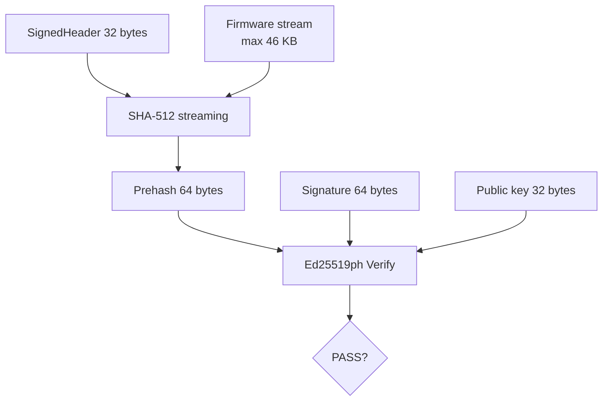

# Firmware Authentication — Ed25519ph + SHA-512

> **Phạm vi (Scope):** Chốt target signing/verification và số byte của header/hash/signature/public key.

> **Tác dụng:** Quy định cách ký và xác thực firmware thống nhất giữa host và STM32.

> **Bên thực hiện:** Máy Release/CI dùng SHA-512 + Ed25519ph để **ký**; STM32
> Application **kiểm tra sơ bộ** candidate; STM32 Bootloader luôn **kiểm
> tra độc lập và là authority cuối** trước install/rollback/boot. ESP32 và AS32
> không được quyết định firmware hợp lệ.

## Phân chia trách nhiệm

| Thành phần | Trách nhiệm |
|---|---|
| Release/CI | Tính SHA-512 và tạo chữ ký Ed25519ph bằng private signing key |
| STM32 Application | Dùng public key để loại candidate sai trước khi publish Staging/Delta và tạo boot request |
| STM32 Bootloader | Tự đọc image, tự tính SHA-512 và verify Ed25519ph lại; kết quả này mới cho phép install, rollback hoặc boot |
| ESP32/AS32 | Chỉ vận chuyển artifact; không giữ private signing key và không cấp quyền install |


## Contract

```text
SHA-512(
  SignedHeader[32 bytes]
  ||
  firmware[image_size]
)
   |
   v
Prehash[64 bytes]
   |
   v
Ed25519ph
   |
   v
Signature[64 bytes]
```

| Item | Size | Tác dụng |
|---|---:|---|
| `Firmware_SignedHeader_t` | 32 bytes | Đưa identity, kích thước, version và CRC firmware vào nội dung được ký. |
| SHA-512 output / prehash | 64 bytes | Digest streaming của `SignedHeader \|\| firmware`, dùng làm đầu vào Ed25519ph. |
| Ed25519ph signature | 64 bytes | Chứng minh artifact được tạo bởi bên giữ private signing key và không bị sửa. |
| Ed25519 public key | 32 bytes | Trust anchor dùng để verify; được cố định ở phía STM32, không lấy từ artifact. |
| Raw Ed25519 seed/private material | 32 bytes | Bí mật chỉ thuộc máy Release/CI để sinh chữ ký, không đưa lên ESP32 hoặc STM32. |
| CRC32 | 4 bytes | Bắt lỗi hỏng byte nhanh trước crypto; không cung cấp tính xác thực. |
| Max Application target | 46 KB | Chặn image vượt phân vùng Application đã khóa trong memory map. |

### SignedHeader byte layout

| Offset | Size | Field | Tác dụng |
|---:|---:|---|---|
| 0 | 16 | `domain` | Chuỗi thô `AEGIS-F103-FW-V1`, tách chữ ký firmware khỏi protocol/artifact khác. |
| 16 | 4 | `format_version` | Phiên bản layout header để parser từ chối format không tương thích. |
| 20 | 4 | `image_size` | Số byte raw firmware thực tế cần hash, verify và giới hạn trong Application. |
| 24 | 4 | `image_version` | Phiên bản firmware dùng cho version policy và chống downgrade. |
| 28 | 4 | `image_crc32` | CRC32 của raw firmware để phát hiện lỗi nhanh; không thay thế Ed25519ph. |

Mọi integer trong SignedHeader dùng little-endian. Domain chứa đúng 16 byte ASCII
và không kèm byte kết thúc chuỗi C.

File private key trên PC có thể dùng encoding khác nên file size không phải wire contract.

Application và Bootloader có thể cùng liên kết một thư viện `firmware_auth`
verify-only, nhưng gọi nó ở hai thời điểm và với hai quyền khác nhau. Application
dùng để loại candidate sai trước khi tạo Backup/reset. Bootloader luôn chạy lại
verification từ byte trong Staging; kết quả sơ bộ của Application không phải
authority và không được tái sử dụng như bằng chứng đã xác thực.

## Chữ ký được giữ ở đâu trong vòng đời firmware

FULL artifact có dạng `SignedHeader || firmware || signature`. Khi nhận artifact,
Application tách raw firmware vào `STAGING_IMAGE`, còn exact SignedHeader và chữ
ký vào Staging manifest. Backup manifest cũng giữ cặp header/signature của App
cũ. Khi một image đã được cài và trở thành App hiện tại, Bootloader lưu cặp đó
trong Metadata A/B để lần reset sau vẫn verify được Internal App.

| Image đang được xét | Nguồn SignedHeader/signature |
|---|---|
| Candidate chưa cài | Staging manifest |
| App cũ dùng rollback | Backup manifest |
| App hiện tại/trial candidate đã cài | Metadata A/B được chọn |

Internal Application chỉ chứa firmware raw, không chứa signature trailer. Vì
vậy `active_signature` trong metadata là input bắt buộc cho việc verify App độc
lập sau reset. Nó xác thực `active_header || App bytes`, không ký generation,
operation state, CRC hoặc commit marker của metadata. Các field metadata còn lại
được bảo vệ chống ghi dở bằng A/B + CRC + commit-last.

Không lưu public key trong metadata: public key thuộc trust anchor cố định của
Bootloader. Không lưu prehash SHA-512 vì Bootloader phải tự đọc image và tính lại;
hash do storage cung cấp không được dùng thay phép verify độc lập.



Verification order: domain/format → nonzero size/range → CRC → SHA-512 stream →
Ed25519ph → target/version policy. Hash hoặc digest do sender cung cấp không thay
việc STM32 tự đọc image và tính lại.
