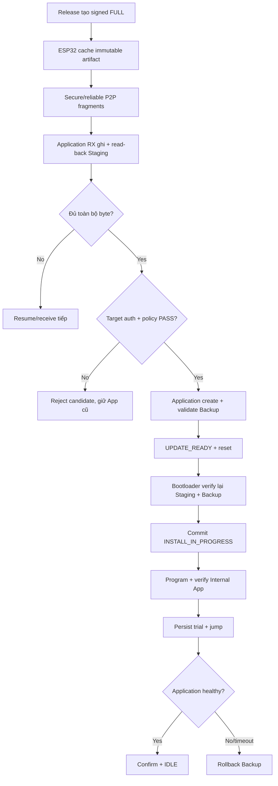

# FULL OTA

> **Phạm vi:** Luồng truyền toàn bộ target firmware qua LoRa P2P. FULL là baseline
> đúng và an toàn phải hoàn thành trước khi coi Delta là optimization hợp lệ.

> **Tác dụng:** Hướng dẫn quy trình FULL OTA chuẩn dùng làm nền cho install và rollback.

## 1. FULL OTA làm gì

FULL gửi toàn bộ firmware mới, không cần firmware base trên thiết bị phải đúng một
phiên bản cụ thể. Đổi lại lượng byte truyền lớn hơn Delta nhưng đường xử lý đơn
giản hơn và luôn được giữ làm fallback.

Target Application tối đa **46 KB**. Staging có **256 KB**, nhưng giới hạn target
vẫn do Internal Application quyết định; dung lượng W25Q32 lớn hơn không cho phép
cài image vượt 46 KB.

## 2. Trách nhiệm từng thành phần

| Thành phần | Việc phải làm |
|---|---|
| Release/CI | Build target, tạo SignedHeader, SHA-512/Ed25519ph signature và artifact immutable |
| ESP32 | Cache artifact, chia fragment, retry/resume và báo progress |
| AS32 | Chuyển byte qua transparent LoRa P2P; không hiểu firmware |
| STM32 Application Update Agent | Authenticate frame, receive/resume, ghi Staging, verify sơ bộ và tạo Backup |
| STM32 Bootloader | Sau reset tự verify Staging/Backup, commit state, ghi Internal Flash và mở Trial Boot |
| Application | Self-check và confirm; nếu không confirm thì Bootloader rollback |

## 3. Luồng end-to-end

## 4. Các checkpoint triển khai

### Receive vào Staging

- `BEGIN` kiểm declared size/identity trước khi erase.
- `DATA` chỉ ACK committed sau write, read-back và receive-progress commit.
- Duplicate cùng nội dung là idempotent; conflicting duplicate bị từ chối.
- `END` chỉ mở verify khi không còn byte thiếu.
- Reset/mất link phải dùng persistent state của STM32/W25Q32 để resume.

### Verify target

Application kiểm sơ bộ trước khi tạo Backup/request. Sau reset, Bootloader tự
stream SignedHeader + firmware vào SHA-512/Ed25519ph verifier. ESP32/Application
không được gửi một cờ `verified=true` để thay bước xác thực độc lập này.

- header format và target/device;
- `image_size <= APPLICATION_SIZE`;
- version/anti-downgrade policy;
- target hash;
- Ed25519ph signature 64 byte bằng public key trong Bootloader.

CRC/read-back chỉ phát hiện lỗi lưu trữ; không thay thế signature.

### Backup và install

Sau preliminary target verify PASS, Application:

1. Invalidate Backup manifest cũ.
2. Copy App hiện tại sang Backup Image và verify.
3. Commit Backup manifest.
4. Ghi `UPDATE_READY(operation_id)` và software reset.

Sau reset, Bootloader:

1. Consume request và match operation ID.
2. Verify độc lập Staging và Backup.
3. Commit metadata `INSTALL_IN_PROGRESS`.
4. Erase/program Application từ Staging và read-back verify.
5. Persist trial state/attempt rồi mới jump target mới.

Nếu target sai thì dừng trước bước 1 và giữ App hiện tại. Không erase App chỉ vì
ESP32 đã gửi `END` hoặc `BOOT`.

### Trial, confirm và rollback

Install thành công chưa đồng nghĩa update thành công. Candidate chỉ trở thành App
ổn định sau self-check và confirm từ chính Application. Reset/IWDG hoặc đạt giới
hạn attempt dẫn tới rollback từ Backup; ESP32 không được confirm thay thiết bị.

## 5. Hành vi khi lỗi

| Lỗi | Kết quả mong đợi |
|---|---|
| Truncated/corrupt DATA | NACK hoặc chờ resume; không verify/install |
| Wrong header/hash/signature | Reject Staging; giữ App cũ |
| W25Q32 write/read-back fail | Không ACK committed; transaction dừng có status |
| Reset lúc nhận | Resume hoặc nhận lại theo persistent receive record |
| Reset lúc tạo Backup | Application resume/recreate; Backup chưa marker invalid, App cũ vẫn nguyên |
| Reset lúc install | Metadata hướng Bootloader tiếp tục install hoặc rollback |
| Trial timeout/fail | Restore Backup, verify, commit App cũ + `IDLE` |
| Không còn App/Backup an toàn | Recovery |

## 6. Điều kiện nghiệm thu FULL OTA

- Valid FULL chạy hết receive → verify → backup → install → trial → confirm.
- Corrupt/truncated/wrong signature/wrong target không erase App hiện tại.
- Duplicate, mất ACK, retry và resume cho kết quả byte-for-byte giống artifact.
- Reset ESP32/AS32/STM32 và power loss tại từng persistent checkpoint có kết quả
  xác định.
- Trial failure khôi phục đúng App cũ và metadata cuối là `IDLE`.
- Lưu artifact bytes, radio bytes, packet/retry count, thời gian và throughput để
  làm baseline so sánh Delta.
