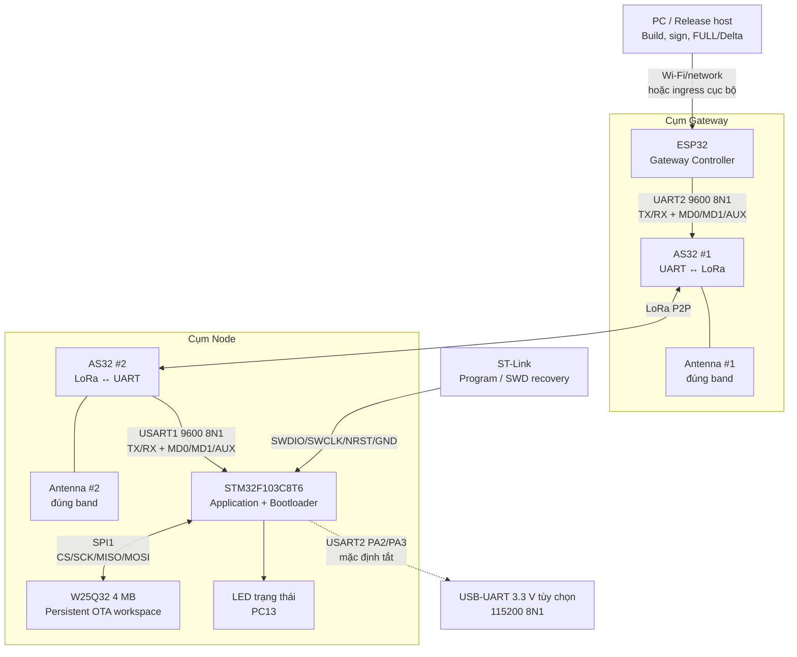
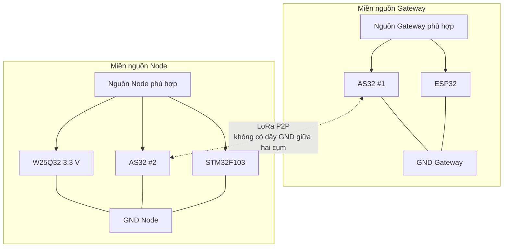

# Sơ đồ kết nối phần cứng Aegis-OTA

> **Tác dụng:** Mô tả các module phần cứng của Aegis-OTA, cách chúng kết nối
> với nhau và chức năng của từng đường tín hiệu để có thể lắp ráp, kiểm tra và
> đối chiếu với source.

> **Phạm vi:** Hệ thống LoRa P2P gồm máy tính/Release host, ESP32 Gateway,
> hai AS32-TTL-100-C, STM32F103C8T6, W25Q32, ST-Link và UART debug tùy chọn.
> Đây là sơ đồ kết nối mức module, không thay thế schematic PCB hoặc datasheet
> của đúng revision phần cứng đang sử dụng.

## 1. Danh sách phần cứng

| Thành phần | Số lượng | Vai trò trong hệ thống |
|---|---:|---|
| PC/Release host | 1 | Build, ký firmware, tạo FULL/Delta artifact và chuyển artifact tới Gateway. |
| ESP32 | 1 | Gateway Controller: cache artifact, chia fragment, retry/resume và điều khiển AS32 #1. |
| AS32-TTL-100-C | 2 | Tạo cầu UART ↔ LoRa P2P ↔ UART giữa Gateway và Node. |
| Antenna đúng band | 2 | Một antenna cho mỗi AS32; phải gắn trước khi phát RF. |
| STM32F103C8T6 | 1 | Chạy Application Update Agent và Bootloader có quyền install/rollback. |
| W25Q32 4 MB | 1 | Lưu Staging, Backup, Delta và Session Journal qua reset/mất nguồn. |
| ST-Link | 1 | Nạp lần đầu, debug SWD và recovery cục bộ. |
| USB-UART 3.3 V | 0 hoặc 1 | Quan sát USART2 debug cục bộ; không thuộc đường OTA. |
| Nguồn ổn áp và tụ decoupling | Theo mạch | Cấp nguồn ổn định, đặc biệt khi AS32 phát và W25Q32 program/erase. |

## 2. Sơ đồ tổng thể

Đường LoRa là hai chiều. Mũi tên trong sơ đồ chỉ cách ghép module, không có
nghĩa AS32 hay ESP32 được quyền xác thực/cài firmware. Quyền cuối cùng vẫn thuộc
Bootloader trên STM32.

## 3. Cụm Gateway: ESP32 ↔ AS32 #1

Pin dưới đây là baseline trong `esp32_gateway/sdkconfig.defaults`. Nếu board
ESP32 thật dùng pin khác, phải đổi cấu hình và cập nhật evidence phần cứng.

| AS32 #1 | ESP32 baseline | Hướng nhìn từ ESP32 | Chức năng |
|---|---|---|---|
| RX | GPIO17 / UART2 TX | ESP32 → AS32 | Gửi command cấu hình hoặc byte OTA. TX phải nối chéo sang RX. |
| TX | GPIO16 / UART2 RX | AS32 → ESP32 | Nhận response, ACK/NACK và byte từ Node. |
| MD0 | GPIO25 | ESP32 → AS32 | Cùng MD1 chọn Normal hoặc Configuration mode. |
| MD1 | GPIO26 | ESP32 → AS32 | Cùng MD0 chọn mode của module. |
| AUX | GPIO27 | AS32 → ESP32 | Báo ready/busy; phần mềm phải chờ bằng timeout hữu hạn. |
| GND | GND | — | Mốc điện áp chung bắt buộc. |
| VCC | Nguồn theo đúng module thật | — | Không lấy điện áp/dòng yêu cầu bằng cách đoán theo tên AS32. |
| ANT | Antenna #1 đúng band | RF | Không phát khi chưa gắn antenna phù hợp. |

Liên kết UART giữa ESP32 và AS32 #1 dùng `9600 8N1`. Đường đưa artifact từ
PC/Cloud tới ESP32 là một hop khác; Wi-Fi/network hoặc USB ingress của ESP32
không làm thay đổi baud của AS32.

## 4. Cụm Node: AS32 #2 ↔ STM32F103

Đây là pin contract production trong `shared/pinout_hw.h`.

| AS32 #2 | STM32F103 | Hướng nhìn từ STM32 | Chức năng |
|---|---|---|---|
| RX | PA9 / USART1_TX | STM32 → AS32 | Gửi ACK/NACK, response và command cấu hình. |
| TX | PA10 / USART1_RX | AS32 → STM32 | Nhận secure OTA frame hoặc response cấu hình. |
| MD0 | PB0 | STM32 → AS32 | Cùng MD1 chọn Normal/Configuration mode. |
| MD1 | PB1 | STM32 → AS32 | Cùng MD0 chọn mode của module. |
| AUX | PB10 | AS32 → STM32 | Báo ready/busy cho driver có timeout. |
| GND | GND | — | Phải chung GND với STM32, W25Q32 và debugger đang gắn. |
| VCC | Nguồn theo đúng module thật | — | Nguồn phải chịu được dòng peak khi phát RF. |
| ANT | Antenna #2 đúng band | RF | Phải cùng band/profile với AS32 #1. |

Hai mode dùng trong project:

| MD0 | MD1 | Mode | Dùng để làm gì |
|---:|---:|---|---|
| 0 | 0 | Normal | Chuyển byte UART qua LoRa P2P hai chiều. |
| 1 | 1 | Configuration | Đọc/ghi config, đọc version hoặc reset module. |

AS32 #2 cũng dùng `9600 8N1`. Hai module phải có profile tương thích về band,
channel, air rate, address/mode, FEC và công suất; giá trị thật phải được đọc lại
từ cả hai module trước khi nghiệm thu.

## 5. STM32F103 ↔ W25Q32

W25Q32 dùng SPI1 Mode 0, nguồn và logic 3.3 V. Các chân `/WP` và `/HOLD` không
do firmware điều khiển nên phải được giữ mức high ổn định theo datasheet/module.

| W25Q32 | STM32F103 | Hướng | Chức năng |
|---|---|---|---|
| `/CS` | PA4 / GPIO output | STM32 → W25Q32 | Chọn chip; idle ở high. |
| `CLK` | PA5 / SPI1_SCK | STM32 → W25Q32 | Clock SPI. |
| `DO` / MISO | PA6 / SPI1_MISO | W25Q32 → STM32 | Trả status, JEDEC ID và dữ liệu. |
| `DI` / MOSI | PA7 / SPI1_MOSI | STM32 → W25Q32 | Gửi command, địa chỉ và dữ liệu program. |
| `/WP` | Kéo lên 3.3 V | — | Tránh kích hoạt write-protect ngoài ý muốn. |
| `/HOLD` | Kéo lên 3.3 V | — | Tránh treo giao dịch SPI ngoài ý muốn. |
| VCC | 3.3 V | — | Đặt tụ decoupling gần chip/module. |
| GND | GND chung | — | Chung mass với STM32 và AS32 #2. |

W25Q32 chỉ là bộ nhớ. Application điều khiển SPI để nhận/chuẩn bị artifact;
Bootloader đọc lại Staging/Backup và tự xác thực trước khi sửa Internal Flash.

## 6. Các kết nối tối thiểu quanh STM32F103C8T6

Nếu dùng board phát triển đã lắp sẵn STM32 thì các kết nối nguồn, reset, BOOT và
clock thường đã có trên board nhưng vẫn phải kiểm tra đúng revision. Nếu dùng
MCU rời/PCB tự thiết kế, phải làm theo datasheet và hardware design guide của
STM32F103C8T6, không chỉ dựa vào bảng tóm tắt này.

| Nhóm chân | Kết nối baseline | Tác dụng |
|---|---|---|
| VDD, VDDA | 3.3 V ổn định | Cấp nguồn digital và analog; cần decoupling đúng khuyến nghị phần cứng. |
| VSS, VSSA | GND | Mốc nguồn; mọi chân nguồn/ground của package phải được nối đúng. |
| BOOT0 | Kéo xuống GND trong chế độ chạy bình thường | Cho MCU boot từ User Flash; chỉ đổi có chủ đích khi dùng ROM bootloader. |
| NRST | Mạch reset theo datasheet và đưa ra ST-Link | Reset thủ công và connect-under-reset. |
| OSC_IN/OSC_OUT | HSE 8 MHz theo phần cứng board | Source hiện tại khai báo `HSE_VALUE=8000000UL` và cấu hình SYSCLK 72 MHz. |

Không được giả định mọi board “Blue Pill” có cùng regulator, crystal, LED hoặc
chip đúng marking. Contract firmware vẫn là STM32F103C8T6 với Flash 64 KB và
SRAM 20 KB.

## 7. ST-Link ↔ STM32F103

| ST-Link | STM32F103 | Chức năng |
|---|---|---|
| SWDIO | PA13 / SWDIO | Dữ liệu debug/program. |
| SWCLK | PA14 / SWCLK | Clock debug/program. |
| NRST | NRST | Cho phép connect-under-reset khi firmware làm MCU khó attach. |
| GND | GND | Mốc tham chiếu bắt buộc. |
| VTref/3.3 V sense nếu có | 3.3 V target | Cho debugger nhận mức logic của target; không mặc nhiên dùng để cấp toàn hệ thống. |

Không tái sử dụng PA13/PA14 cho ngoại vi khác. Recovery chính thức của project
dùng ST-Link/SWD; thiếu W25Q32 hoặc AS32 không ngăn ST-Link kết nối với STM32.

## 8. UART debug cục bộ và LED

| Tín hiệu | STM32F103 | Kết nối | Ghi chú |
|---|---|---|---|
| Debug TX | PA2 / USART2_TX | RX của USB-UART 3.3 V | Tùy chọn, `115200 8N1`, mặc định tắt. |
| Debug RX | PA3 / USART2_RX | TX của USB-UART 3.3 V | Không dùng làm đường OTA hoặc Recovery. |
| Status LED | PC13 | LED board hoặc LED ngoài phù hợp | Chỉ báo trạng thái; kiểm tra active-high/active-low của board thật. |
| GND | GND | GND USB-UART | Phải chung mass khi cắm UART debug. |

Không nối trực tiếp tín hiệu UART mức 5 V vào STM32 hoặc ESP32. Nếu adapter có
jumper mức logic, phải chọn 3.3 V trước khi kết nối.

## 9. Nguồn, mass và RF

- Không cấp nguồn cho AS32 từ một GPIO hoặc chân nguồn không đủ dòng peak.
- Không nối song song nhiều nguồn 3.3 V nếu chưa xác định rõ hướng cấp và khả
  năng back-power của từng board.
- ESP32 và AS32 #1 phải chung GND vì có UART dây; STM32, W25Q32, AS32 #2,
  ST-Link và USB-UART đang cắm cũng phải chung GND.
- Link giữa hai AS32 là RF nên hai cụm không cần nối GND xuyên khoảng cách.
- Gắn đúng antenna/band trước khi phát; không suy đoán tần số từ source code.
- Đặt tụ decoupling sát W25Q32 và bảo đảm rail không sụt khi AS32 phát.

## 10. Trình tự lắp và bring-up an toàn

1. Đối chiếu đúng marking, revision, band, pinout và điện áp của từng module.
2. Khi chưa cấp nguồn, kiểm tra chạm VCC-GND và kiểm lại TX/RX đã nối chéo.
3. Lắp STM32 + ST-Link trước; xác nhận SWD attach và đọc được MCU.
4. Lắp W25Q32; đọc đúng JEDEC ID rồi mới test erase/program ở vùng test.
5. Lắp từng AS32 với antenna và nguồn phù hợp; chỉ đọc config/version lần đầu.
6. Xác nhận hai module có profile tương thích rồi mới chạy packet P2P hai chiều.
7. Gắn toàn hệ thống, kiểm timeout/AUX, sau đó mới chạy FULL/Delta OTA.
8. Lưu wiring, config read-back, nguồn, khoảng cách và log vào evidence; build
   thành công không được thay cho trạng thái hardware PASS.

## 11. Checklist trước khi cấp nguồn

- [ ] Đúng STM32F103C8T6 và W25Q32 3.3 V.
- [ ] Hai AS32 đúng model/band và đã gắn antenna phù hợp.
- [ ] TX/RX của từng UART được nối chéo.
- [ ] MD0, MD1 và AUX đúng GPIO, không để floating.
- [ ] W25Q32 `/CS`, `/WP` và `/HOLD` có mức idle xác định.
- [ ] SWDIO, SWCLK, NRST và GND của ST-Link đúng chân.
- [ ] Mọi thiết bị có dây tín hiệu trực tiếp đều có GND chung.
- [ ] Không có UART 5 V đi thẳng vào STM32/ESP32.
- [ ] Nguồn đủ dòng peak và không có hai nguồn đánh ngược nhau.
- [ ] Profile thật của hai AS32 sẽ được read-back trước khi phát OTA.

## 12. Nguồn contract để đối chiếu

- `shared/pinout_hw.h`: pin AS32 #2, W25Q32, UART debug và LED phía STM32.
- `esp32_gateway/sdkconfig.defaults`: pin AS32 #1 mặc định phía ESP32.
- [LoRa/AS32_Hardware_Profile.md](LoRa/AS32_Hardware_Profile.md): inventory,
  read-back và evidence của đúng hai module AS32 thật.
- [as32-lora-p2p.md](as32-lora-p2p.md): mode, command và điều kiện nghiệm thu P2P.
- [memory-map.md](memory-map.md): phân vùng logic của Internal Flash và W25Q32;
  đây không phải sơ đồ dây.
- [component-responsibilities.md](component-responsibilities.md): quyền hạn của
  từng thành phần sau khi phần cứng đã kết nối.
