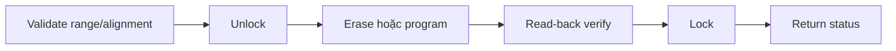

# Internal Flash Contract

> **Phạm vi:** Hợp đồng erase, program và read-back vùng Internal Flash do
> Bootloader quản lý. Đây là đặc tả nền cho checkpoint Phase 1.1.

> **Tác dụng:** Chốt các API và điều kiện an toàn khi Bootloader ghi Internal Flash.

> **Bên thực hiện:** STM32 Bootloader sở hữu API erase/program Application và
> Metadata A/B. Application chỉ được đọc vùng App đang chạy và không gọi API ghi
> Internal Flash này.

## 1. Phân vùng được phép truy cập

| Vùng | Địa chỉ | Kích thước | Quyền của `flash_program` |
|---|---:|---:|---|
| Bootloader | `0x08000000` | 16 KB | Chỉ đọc, tuyệt đối không erase/program |
| Application | `0x08004000` | 46 KB | Được erase/program/verify |
| Metadata A | `0x0800F800` | 1 KB | Được erase/program/verify |
| Metadata B | `0x0800FC00` | 1 KB | Được erase/program/verify |

Miền ghi hợp lệ là nửa khoảng
`[APPLICATION_BASE_ADDRESS, METADATA_END_ADDRESS)`. Mọi phép kiểm tra phải chống
tràn số khi tính địa chỉ cuối; không dùng trực tiếp `address + length` để kết luận
nếu chưa loại trừ overflow.

## 2. Hợp đồng API

| API | Trách nhiệm |
|---|---|
| `FlashProgram_Unlock()` | Mở khóa bộ điều khiển Flash và trả trạng thái |
| `FlashProgram_Lock()` | Khóa lại bộ điều khiển Flash và xác nhận trạng thái khóa |
| `FlashProgram_ErasePage()` | Erase đúng một page 1 KB, sau đó kiểm tra toàn page là `0xFF` |
| `FlashProgram_WriteHalfWord()` | Ghi một half-word 2 byte và read-back ngay giá trị vừa ghi |
| `FlashProgram_WriteBuffer()` | Ghi buffer theo từng half-word, hỗ trợ length lẻ theo quy tắc padding |
| `FlashProgram_Verify()` | So sánh byte trong Flash với buffer nguồn, không thay đổi Flash |

Các API erase/write cấp cao tự quản lý vòng đời unlock/lock. Caller không cần
unlock trước khi gọi và không được dựa vào việc Flash còn mở khóa sau khi hàm trả
về.

## 3. Điều kiện đầu vào

- Pointer nguồn không được `NULL` khi `length > 0`.
- `length` phải lớn hơn `0` đối với thao tác buffer/verify.
- Địa chỉ erase phải thẳng hàng page 1 KB.
- Địa chỉ program half-word/buffer phải thẳng hàng 2 byte.
- Toàn bộ vùng bị tác động, kể cả byte padding, phải nằm trong miền ghi hợp lệ.
- Caller phải erase page trước khi viết lại; API write không tự erase và không
  thể khôi phục bit Flash từ `0` về `1`.

Với buffer có length lẻ, byte cuối được ghép với byte cao `0xFF`. Việc ghi chỉ
được tiếp tục nếu byte padding hiện vẫn là `0xFF`; như vậy dữ liệu nằm ngoài
length của caller không bị sửa ngoài ý muốn.

## 4. Trình tự và bất biến lỗi



- Mọi vòng chờ phần cứng phải hữu hạn; timeout được trả về caller.
- Sau một transaction, module luôn thử khóa Flash lại, kể cả khi thao tác chính
  thất bại.
- Nếu thao tác chính đã lỗi và bước lock cũng lỗi, trạng thái của lỗi chính được
  giữ lại để không che mất nguyên nhân ban đầu.
- Một lần write chỉ được báo `FLASH_PROGRAM_OK` sau khi read-back đúng dữ liệu
  caller yêu cầu.

## 5. Ý nghĩa nhóm trạng thái

- `FLASH_PROGRAM_INVALID_ARGUMENT`: pointer/length không hợp lệ.
- `FLASH_PROGRAM_OUT_OF_RANGE`: một phần thao tác nằm ngoài Application +
  Metadata A/B.
- `FLASH_PROGRAM_UNALIGNED`: địa chỉ không đúng alignment của page hoặc
  half-word.
- `FLASH_PROGRAM_BUSY`, `FLASH_PROGRAM_TIMEOUT`: Flash controller chưa sẵn
  sàng hoặc chờ quá giới hạn.
- `FLASH_PROGRAM_PROGRAM_ERROR`, `FLASH_PROGRAM_WRITE_PROTECTED`: lỗi phần
  cứng khi erase/program.
- `FLASH_PROGRAM_LOCK_FAILED`: không thể đưa Flash về trạng thái khóa.
- `FLASH_PROGRAM_VERIFY_FAILED`: dữ liệu read-back khác dữ liệu mong đợi.

## 6. Quy tắc cài đặt firmware

```text
verified STAGING
 -> valid BACKUP
 -> commit INSTALL_IN_PROGRESS
 -> erase/program Application
 -> read-back verify
 -> Trial Boot
```

Không erase Application đang chạy trước khi firmware trong Staging đã được xác
thực, Backup đã hợp lệ và metadata `INSTALL_IN_PROGRESS` đã commit bền vững.

## 7. Điều kiện nghiệm thu Phase 1.1

- Từ chối mọi range chạm Bootloader hoặc vượt cuối Metadata B.
- Từ chối địa chỉ sai alignment.
- Erase page, ghi buffer chẵn/lẻ và verify thành công trên board.
- Phát hiện được verify mismatch và không để Flash mở khóa sau khi API kết thúc.
