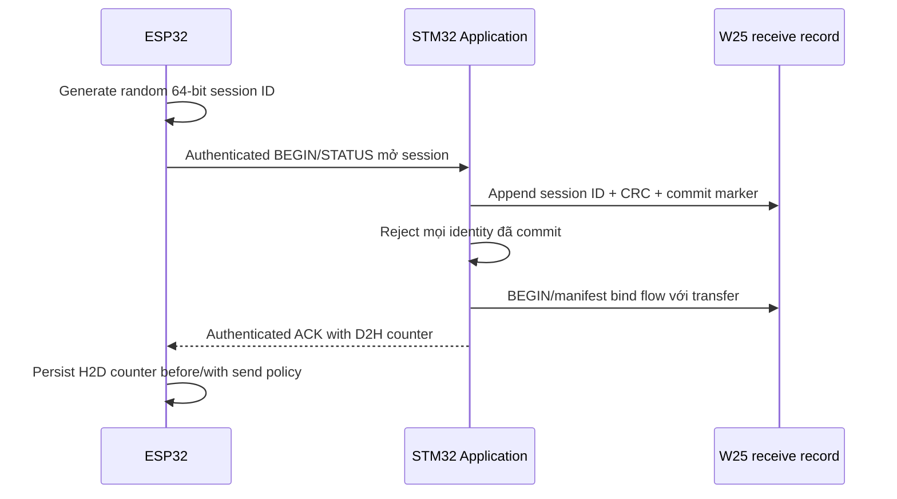

# Key and Session Lifecycle

> **Phạm vi:** Nguồn gốc, nơi lưu và vòng đời của signing key, verify key và transport key.

> **Tác dụng:** Hướng dẫn tạo, provision, sử dụng và thay thế key/session an toàn.

> **Bên thực hiện:** Release/CI quản lý signing key; ESP32 và STM32 Application
> quản lý transport session; STM32 Application kiểm tra chữ ký sơ bộ và
> Bootloader kiểm tra chữ ký độc lập với quyền quyết định cuối.

## Hai trust domain độc lập

| Key/value | Size | Nơi tồn tại | Mục đích |
|---|---:|---|---|
| Ed25519 private signing key | 64 bytes expanded / 32 bytes seed | Release machine/CI secret store | Ký FULL target và Delta manifest |
| Ed25519 public verify key | 32 bytes | Bootloader và Application verifier | Xác thực release artifact |
| SHA-512 digest | 64 bytes | Giá trị tạm khi sign/verify | Prehash cho Ed25519ph |
| ChaCha20-Poly1305 transport key | 32 bytes | ESP32 và STM32 Application | Bảo vệ P2P frame |
| Session ID | 8 bytes | Hai endpoint trong một session | Thành phần nonce và session identity |
| Frame counter | 4 bytes mỗi hướng | Endpoint tương ứng | Thành phần nonce/anti-replay |

Transport key không được so sánh hoặc dẫn xuất trực tiếp từ firmware public key.
ESP32 không giữ release private signing key.

## Provisioning

- Release private key được tạo và giữ ngoài repository/device.
- Public verify key được build vào image tin cậy và có fingerprint được ghi trong
  release evidence.
- Baseline dùng transport PSK riêng cho từng device; không commit PSK thật vào repo.
- Provision tool ghi cùng device identity/transport key vào ESP32 và STM32 qua
  kênh local được kiểm soát.
- Test key phải được đánh dấu rõ và không dùng cho release artifact.

## Session establishment

STM32F103 không được giả lập random session ID bằng tick/reset counter. ESP32 tạo
session ID bằng nguồn ngẫu nhiên của nó. Một session chỉ được dùng với đúng
transport key và hai counter domain đã chốt.

Production receiver chỉ cho `BEGIN` hoặc `STATUS` mở session mới. Trước response đầu tiên,
Application append ID vào Session Journal 64 KB trên W25Q32. Journal giữ 4096
ID, không tự wrap/erase và fail-closed khi đầy hoặc corrupt. Chỉ local
reprovision flow được erase journal sau khi đã thay transport key.

## Counter rules

- Host → Device bắt đầu trong `0x00000000..0x7FFFFFFF`.
- Device → Host bắt đầu trong `0x80000000..0xFFFFFFFF`.
- Mỗi frame mới, kể cả retry cùng SEQ, dùng counter mới.
- Receiver chỉ accept counter theo replay policy sau khi TAG PASS.
- Sender hoặc receiver reboot phải mở session ID mới trước khi gửi tiếp; BEGIN
  mới sau đó resume transfer theo manifest/bitmap persistent.
- Counter không wrap; chạm giới hạn phải đóng session và mở session mới.
- W25 progress không được cập nhật khi frame authentication thất bại.

## Session termination

Session kết thúc khi transfer complete/abort, timeout toàn phiên, counter sắp hết
hoặc endpoint reboot mà không khôi phục counter. Receive record vẫn giữ artifact
identity/progress để một session mới có thể hỏi STATUS và resume an toàn.

## Acceptance

- Reused `(transport key, session ID, counter)` bị phát hiện trong test.
- Reset ESP32/STM32 không làm counter quay lại với session cũ.
- Replay, wrong direction domain và stale session không thay W25 state.
- Không file build/log/evidence nào chứa private signing key hoặc transport PSK thật.
