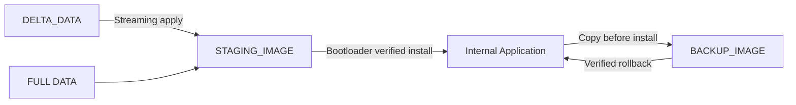

# Memory Map

> **Phạm vi (Scope):** Chốt memory contract, dùng KB/MB thống nhất.

> **Tác dụng:** Cung cấp địa chỉ và kích thước chuẩn cho linker, driver và storage.


> `1 KB = 1024 bytes`, `1 MB = 1024 KB`.

Trong code, mọi macro `*_END` là địa chỉ **exclusive**; byte hợp lệ cuối cùng
của một vùng là `*_END - 1`.

### STM32F103C8T6

Internal Flash: **64 KB**  
SRAM: **20 KB**

| Region | Address | Size | Tác dụng |
|---|---|---:|---|
| Bootloader | `0x08000000..0x08003FFF` | 16 KB | Code tin cậy chạy sau reset, xác thực và cài/rollback Application. |
| Application | `0x08004000..0x0800F7FF` | 46 KB | Chứa raw firmware đang hoạt động và Application Update Agent. |
| Metadata A | `0x0800F800..0x0800FBFF` | 1 KB | Một page của cặp persistent record A/B dùng để commit trạng thái boot an toàn. |
| Metadata B | `0x0800FC00..0x0800FFFF` | 1 KB | Page còn lại để ghi generation mới mà không phá record hợp lệ đang dùng. |

Mỗi page Metadata chứa một record v2 dài 128 bytes ở đầu page; phần còn lại giữ
erased. Hai page riêng tồn tại để commit A/B an toàn theo erase granularity 1 KB,
không phải vì record cần đủ 1 KB. Record giữ active SignedHeader 32 bytes và
Ed25519ph signature 64 bytes vì Internal Application chỉ chứa raw firmware;
Bootloader cần cặp này để verify App độc lập sau mỗi reset.

### W25Q32

| Region | Address | Size | Tác dụng |
|---|---|---:|---|
| STAGING | `0x000000..0x03FFFF` | 256 KB | Giữ full candidate đã reconstruct/verify để Bootloader cài vào Internal Application. |
| BACKUP | `0x040000..0x07FFFF` | 256 KB | Giữ bản App cũ đã xác thực để Bootloader rollback khi trial thất bại. |
| DELTA | `0x080000..0x0BFFFF` | 256 KB | Giữ Delta package và progress; Application dùng nó để dựng full target sang Staging. |
| RESERVED | `0x0C0000..0x3FFFFF` | 3.25 MB | Vùng cha cho journal chống replay và phần mở rộng sau này. |

RESERVED được chia tiếp:

```text
SESSION_JOURNAL  0x0C0000..0x0CFFFF   64 KB
FUTURE_RESERVED  0x0D0000..0x3FFFFF   3.1875 MB
```

Session journal là append-only, lưu tối đa 4096 session ID đã được accept để
session cũ không thể mở lại sau reset và gây reuse AEAD nonce. Phần
`FUTURE_RESERVED` vẫn không được production storage tự ý ghi.

BACKUP:

```text
BACKUP_MANIFEST  0x040000..0x040FFF  4 KB
BACKUP_IMAGE     0x041000..0x07FFFF  252 KB
```

STAGING:

```text
STAGING_MANIFEST 0x000000..0x000FFF  4 KB
STAGING_IMAGE    0x001000..0x03FFFF  252 KB
```

Sector manifest lưu identity, SignedHeader/signature, receive progress và các
commit marker. `STAGING_IMAGE` chỉ chứa raw firmware; offset image `0` ánh xạ tới
`0x001000`, không ánh xạ tới đầu chip W25Q32.

DELTA:

```text
DELTA_MANIFEST  0x080000..0x080FFF  4 KB
DELTA_DATA      0x081000..0x0BFFFF  252 KB
```

## Invariant

- Mỗi manifest chiếm đúng một erase sector 4 KB.
- Staging, Backup và Delta không chồng nhau và không đi vào Reserved.
- Chỉ `transport_session_store` được ghi Session Journal; journal không chạm
  phần Future Reserved.
- Firmware target tối đa 46 KB dù Staging Image và Backup Image đều lớn hơn.
- Delta reconstruct ghi vào Staging Image, tuyệt đối không ghi trực tiếp App.
- Mọi API storage nhận offset tương đối với phần `*_IMAGE` hoặc `*_DATA`, không
  nhận địa chỉ W25Q32 tuyệt đối từ protocol layer.


