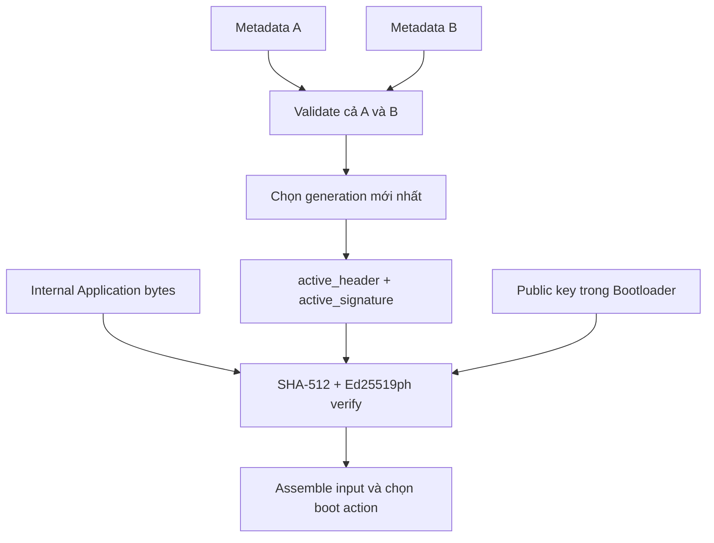
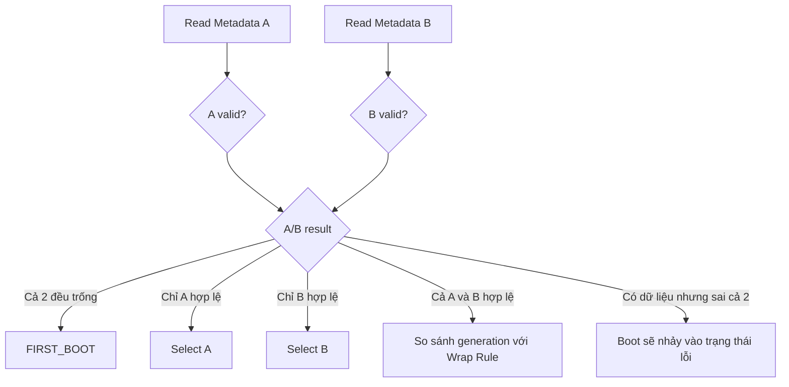
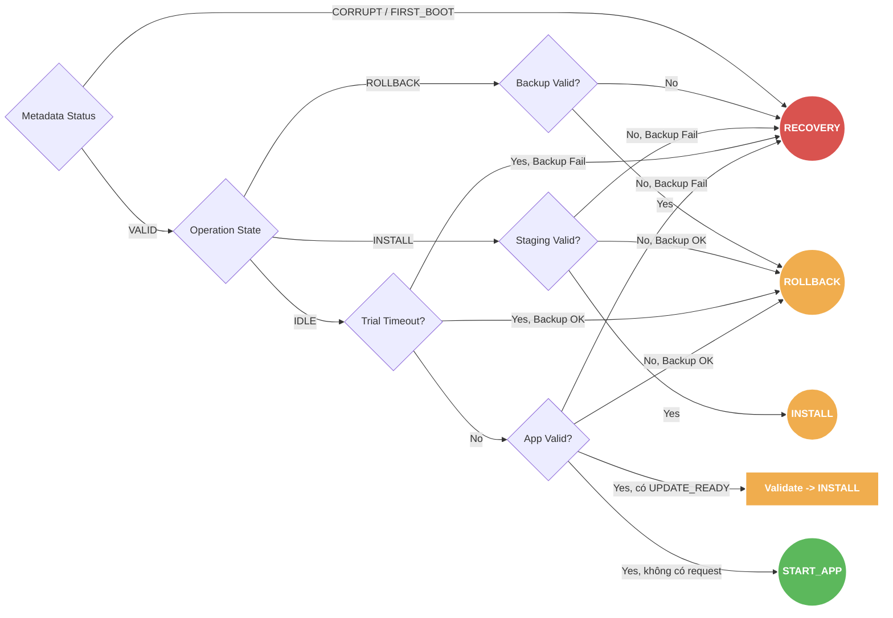

# Metadata and Boot Decision

> **Phạm vi:** Persistent record trong Internal Flash và cách Bootloader chọn action sau reset.

> **Tác dụng:** Hướng dẫn lưu trạng thái bền vững và quyết định boot an toàn sau mọi reset.

> **Bên thực hiện:** STM32 Bootloader là bên duy nhất đọc/commit Metadata A/B và
> đưa ra boot action. Application, ESP32 và AS32 không được sửa metadata hoặc tự
> quyết định install/rollback.

## Metadata A/B

Metadata A và B nằm ở hai page Internal Flash riêng. Khi reset, Bootloader luôn
đọc và validate **cả hai record**, sau đó chọn record hợp lệ mới nhất theo
`generation`; nó không chọn cố định A hoặc B. Mỗi lần commit ghi record mới sang
page không active, verify body rồi program commit marker cuối.

Mỗi page rộng 1 KB vì đó là erase granularity của STM32F103, nhưng chỉ 128 bytes
đầu page chứa một record. Phần còn lại giữ erased; record 128 bytes có layout:

| Offset | Size | Field | Ý nghĩa |
|---:|---:|---|---|
| 0 | 4 | `magic` | Nhận diện record |
| 4 | 4 | `format_version` | Phiên bản schema persistent |
| 8 | 4 | `generation` | Chọn record mới hơn giữa A/B |
| 12 | 1 | `operation_state` | IDLE/INSTALL/ROLLBACK |
| 13 | 1 | `trial_boot_flag` | Candidate đang trong Trial Boot |
| 14 | 1 | `boot_attempt_count` | Số lần đã cho phép trial jump |
| 15 | 1 | `reserved` | Phải bằng 0 |
| 16 | 8 | `operation_id` | Bind transaction với đúng W25 manifest/request |
| 24 | 32 | `active_header` | SignedHeader mô tả App hiện nằm trong Internal Flash |
| 56 | 64 | `active_signature` | Ed25519ph signature xác thực `active_header \|\| App bytes` |
| 120 | 4 | `metadata_crc32` | CRC byte `[0, 120)` |
| 124 | 4 | `commit_marker` | Ghi cuối để publish record |

Mọi integer serialized little-endian. `operation_id` khác 0 khi INSTALL/ROLLBACK
đang dở hoặc khi candidate còn ở Trial Boot. IDLE ổn định sau confirm/rollback có
`operation_id == 0`. Record vừa khít 128 bytes và nằm gọn trong page 1 KB.

Giá trị khóa: magic `0x41454749`, format `2`, commit marker `0x434D4954`;
erased word là `0xFFFFFFFF`.

## Vì sao metadata phải giữ SignedHeader và chữ ký

Vùng Application chỉ chứa raw firmware bytes; chữ ký không được nối vào cuối App
slot. Vì vậy sau một reset, để tự xác thực App hiện tại mà không phụ thuộc
W25Q32, Bootloader cần lấy:

```text
active_header[32]      từ Metadata đã chọn
Application[image_size] từ Internal Flash
active_signature[64]   từ Metadata đã chọn
public_key[32]         cố định trong Bootloader
```

Bootloader tự tính `SHA-512(active_header || Application)` rồi verify
`active_signature` bằng public key. Chữ ký này **không phải chữ ký của record
metadata**; nó là chữ ký firmware do Release/CI tạo và được copy nguyên vẹn qua
Staging/Backup vào metadata khi image trở thành App hiện tại.

`metadata_crc32` và Ed25519ph không thay thế nhau:

| Cơ chế | Bảo vệ điều gì |
|---|---|
| Metadata CRC32 | Phát hiện record hỏng, ghi dở hoặc bit lỗi |
| Commit marker | Chứng minh record đã được publish hoàn chỉnh |
| Ed25519ph signature | Chứng minh header + App bytes đến từ Release/CI hợp lệ |

Public key không lưu trong metadata vì metadata là vùng có thể cập nhật. Private
key chỉ tồn tại ở Release/CI và không bao giờ được flash vào STM32.

Không được bỏ `active_signature` để rút record. Bỏ field này sẽ khiến Bootloader
chỉ còn CRC không có tính xác thực, hoặc phải phụ thuộc vào W25Q32 mỗi lần boot.
Giảm 64 bytes cũng không thu hồi được page Flash nào vì A/B vẫn phải dùng hai
erase page 1 KB để commit an toàn. Layout 128 bytes vì vậy được giữ cố định.



## Persistent operation state

```text
METADATA_OPERATION_IDLE
METADATA_OPERATION_INSTALL_IN_PROGRESS
METADATA_OPERATION_ROLLBACK_IN_PROGRESS
```

Receive FULL/Delta, progress bitmap, Delta apply và Backup preparation được lưu
trong W25Q32 manifest. Internal metadata chỉ checkpoint thao tác có thể phá hủy
Internal Application.

## Chọn record



- Generation bằng nhau chọn A ổn định.
- Chênh đúng `0x80000000` là ambiguous và fail-closed.
- `FIRST_BOOT` không tự động có nghĩa Application bootable.
- Board provision ban đầu phải ghi metadata đúng cho factory Application; nếu
  chưa provision thì FIRST_BOOT đi Recovery/provisioning.

## Định nghĩa validity

`app_valid` chỉ true khi:

- MSP/reset vector nằm trong SRAM/App range hợp lệ;
- `active_header.image_size` nằm trong `APPLICATION_SIZE`;
- CRC của App khớp SignedHeader;
- SHA-512 + Ed25519ph đúng theo public key/policy;
- identity/version khớp metadata được chọn.

Metadata được chọn chỉ cung cấp persistent state và danh tính/bằng chứng của App.
Boot action cuối còn kết hợp kết quả verify App, mailbox, Staging/Backup validity
và Trial policy; chỉ đọc `operation_state` chưa đủ để quyết định boot.

`staging_valid` và `backup_valid` yêu cầu manifest committed, operation/artifact
identity đúng, range hợp lệ, image CRC và Ed25519ph đều PASS.

## Boot priority



Target update sai không làm thiết bị vào Recovery khi App hiện tại vẫn valid.
Bootloader consume request sai, invalidate/reject candidate theo policy rồi boot
App hiện tại.

## Invariant và acceptance

- Không erase record valid duy nhất trước khi record mới commit.
- Không boot default metadata có `active_header.image_size == 0`.
- Không xử lý update mới khi trial chưa confirm/rollback xong.
- Attempt được commit trước mỗi trial jump.
- Reset trước/sau mọi commit chọn được một record hoàn chỉnh.
- Table test bao phủ FIRST_BOOT, CORRUPT, normal, update request, install resume,
  rollback resume, trial còn lượt và trial hết lượt.
