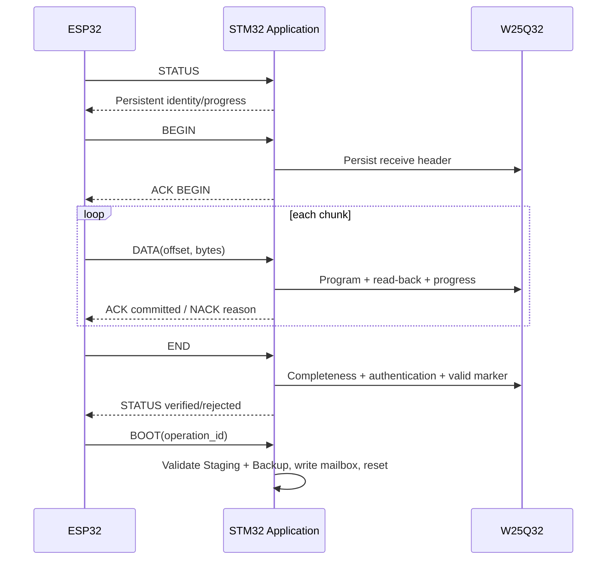

# OTA P2P Protocol

> **Phạm vi:** Logical command chạy trong secure frame giữa ESP32 và STM32 Application.

> **Tác dụng:** Chốt command, payload, ACK/NACK và quy tắc retry/resume của OTA P2P.

> **Bên thực hiện:** ESP32 Gateway là sender/controller; STM32 Application là
> receiver/responder. AS32 chỉ chuyển byte và Bootloader không xử lý command P2P.

## Boundary

```text
AS32 #2 UART bytes
 -> bounded secure-frame parser
 -> CRC/session/counter/TAG/decrypt
 -> logical OTA command
 -> Application artifact storage
 -> W25Q32
```

Bootloader không nhận normal P2P command. `BOOT` chỉ yêu cầu Application ghi
`UPDATE_READY` và reset sau khi artifact/Backup đã sẵn sàng; nó không cấp quyền
install cho ESP32.

## Message type

| Value | Name | Hướng | Tác dụng |
|---:|---|---|---|
| `0x01` | BEGIN | ESP32 → STM32 | Tạo transfer mới hoặc nối lại transfer có identity trùng khớp. |
| `0x02` | DATA | ESP32 → STM32 | Chuyển một đoạn manifest hoặc artifact data vào đúng offset. |
| `0x03` | END | ESP32 → STM32 | Yêu cầu kiểm tra nhận đủ, hash, chữ ký và policy trước khi commit artifact valid. |
| `0x04` | ABORT | ESP32 → STM32 | Hủy đúng transfer được chỉ định và invalidate trạng thái nhận theo policy. |
| `0x05` | STATUS | ESP32 → STM32 | Hỏi trạng thái bền vững và vị trí dữ liệu còn thiếu để resume. |
| `0x06` | BOOT | ESP32 → STM32 | Yêu cầu App kiểm tra điều kiện, ghi `UPDATE_READY` rồi reset; không trực tiếp cấp quyền install. |
| `0x80` | ACK | STM32 → ESP32 | Báo request đã được chấp nhận và phần dữ liệu liên quan đã commit khi cần. |
| `0x81` | NACK | STM32 → ESP32 | Báo request bị từ chối cùng nguyên nhân và vị trí nên retry/resume. |
| `0x82` | STATUS_RESPONSE | STM32 → ESP32 | Trả identity, tiến độ và trạng thái persistent của transfer đang được hỏi. |

Tất cả integer little-endian. Payload được serialize thủ công; không cast trực
tiếp packed struct vào UART bytes.

## Payload contract

### BEGIN — 33 bytes

| Field | Size | Tác dụng |
|---|---:|---|
| `transfer_id` | 8 | Nhận diện phiên truyền để DATA/END/STATUS và resume trỏ đúng record. |
| `artifact_id` | 8 | Nhận diện nội dung FULL/Delta cụ thể, độc lập với lần cài đặt. |
| `operation_id` | 8 | Liên kết Staging, Backup, mailbox và Metadata của cùng một lần update. |
| `artifact_type` | 1 | Chọn luồng lưu trữ/xác thực: `FULL=1`, `DELTA=2`. |
| `manifest_size_le` | 2 | Giới hạn số byte manifest receiver phải nhận và kiểm tra. |
| `data_size_le` | 4 | Giới hạn kích thước raw firmware hoặc patch data và chống vượt phân vùng. |
| `data_chunk_size_le` | 2 | Khóa kích thước chunk dùng cho DATA/progress bitmap; baseline 224 bytes. |

BEGIN ACK chỉ sau khi receiver đã validate range/format, chọn resume hoặc prepare
transfer mới và persist receive header. `operation_id` là ID ngẫu nhiên của lần
install, được bind với Staging, Backup và boot mailbox; nó không thay artifact ID.

### DATA — 15-byte envelope + data

| Field | Size | Tác dụng |
|---|---:|---|
| `transfer_id` | 8 | Ràng buộc DATA với đúng transfer đang active. |
| `section` | 1 | Chọn không gian offset: `MANIFEST=0` hoặc `DATA=1`. |
| `offset_le` | 4 | Vị trí tương đối trong section đã chọn, không phải địa chỉ W25Q32 tuyệt đối. |
| `data_length_le` | 2 | Số byte thực tế trong field data; phải không quá 224. |
| `data` | `data_length` | Các byte cần program, read-back và đánh dấu progress sau khi thành công. |

`data_length <= 224`, vì secure-frame payload tối đa 256 bytes. Manifest có thể
được truyền nhiều DATA frame. Offset của MANIFEST và DATA thuộc hai range riêng.

DATA ACK chỉ sau:

```text
program -> read-back -> progress commit
```

### END, ABORT, STATUS và BOOT

| Command | Payload | Tác dụng của payload |
|---|---|---|
| END | `transfer_id[8]` | Chỉ định chính xác transfer cần kiểm tra completeness và authenticity. |
| ABORT | `transfer_id[8]` | Chỉ định transfer cần hủy, tránh xóa nhầm record khác. |
| STATUS | `transfer_id[8]`; toàn 0 để hỏi active transfer | Hỏi một transfer cụ thể hoặc yêu cầu receiver trả transfer đang active. |
| BOOT | `operation_id[8]` | Ràng buộc boot request với đúng Staging và Backup đã chuẩn bị. |

END chỉ khởi động completeness/authentication check; nó không tự làm artifact
valid. BOOT chỉ được ACK sau khi operation ID, valid Staging và valid Backup khớp.

### ACK/NACK — 14 bytes

| Field | Size | Tác dụng |
|---|---:|---|
| `request_type` | 1 | Cho biết ACK/NACK đang phản hồi command nào. |
| `status_or_reason` | 1 | Mã thành công hoặc nguyên nhân từ chối để sender quyết định retry/dừng. |
| `transfer_id` | 8 | Ràng buộc phản hồi với đúng transfer. |
| `next_missing_offset_le` | 4 | Chỉ vị trí chưa commit tiếp theo để sender resume đúng chỗ. |

NACK reason gồm bad format/session/replay/transfer/artifact/state/range/offset,
conflicting duplicate, storage error, incomplete, auth fail, policy reject và timeout.

### STATUS_RESPONSE — 32 bytes

| Field | Size | Tác dụng |
|---|---:|---|
| `receive_state` | 1 | Tóm tắt trạng thái nhận hiện tại: idle, receiving, complete, verified hoặc rejected. |
| `artifact_type` | 1 | Cho biết record đang chứa FULL hay DELTA. |
| `transfer_id` | 8 | Nhận diện phiên truyền mà status đang mô tả. |
| `artifact_id` | 8 | Nhận diện artifact cụ thể của phiên truyền đó. |
| `data_size_le` | 4 | Tổng số byte data receiver đang chờ hoặc đã nhận. |
| `chunk_size_le` | 2 | Kích thước chunk persistent dùng để diễn giải progress. |
| `next_missing_offset_le` | 4 | Offset đầu tiên chưa commit để sender tiếp tục truyền. |
| `flags_le` | 4 | Bitfield tóm tắt marker và tiến độ persistent theo bảng dưới. |

| Bit | Tên | Ý nghĩa |
|---:|---|---|
| 0 | `HEADER_COMMITTED` | Manifest header đã commit và có thể resume. |
| 1 | `ARTIFACT_VALID` | FULL image hoặc Delta patch đã đủ byte và verify thành công. |
| 2 | `APPLY_STARTED` | Delta reconstruct đã bắt đầu; marker này không bị ghi ngược về erased. |
| 3 | `BACKUP_VALID` | Backup cùng `operation_id` đã commit và verify. |
| 4 | `STAGING_READY` | Staging đang chứa full target hợp lệ; với Delta nghĩa là reconstruct đã hoàn tất. |
| 5 | `INSTALLED` | Metadata active khớp target; candidate đã được ghi vào Internal Flash. |
| 6 | `CONFIRMED` | Metadata active khớp target và Trial Boot đã được Application xác nhận. |

`CONFIRMED` luôn kéo theo `INSTALLED`; `STAGING_READY` kéo theo
`ARTIFACT_VALID`. `INSTALLED`/`CONFIRMED` lấy từ Metadata active nên vẫn có thể
đúng sau khi Staging đã được tái sử dụng. `APPLY_STARTED` chỉ hợp lệ với Delta.

## Stop-and-wait, duplicate và resume



- Một thời điểm chỉ có một DATA chưa ACK.
- Timeout/retry hữu hạn và có backoff.
- Duplicate giống hệt block đã commit được ACK lại.
- Cùng offset nhưng payload khác bị NACK.
- Out-of-order bị NACK kèm expected/next missing offset.
- STM32/W25Q32 là source of truth; ESP32 không resume theo RAM riêng.
- Không có remote CONFIRM. Trial confirm chỉ do STM32 Application self-check tạo.

## Acceptance

- Fake transport test parser/command không cần AS32.
- Golden payload C/Python/ESP32 giống byte-for-byte.
- Truncated/trailing/overflow và section crossing đều bị từ chối.
- Drop ACK tạo duplicate nhưng storage cuối vẫn đúng một nội dung.
- Reset hai endpoint rồi STATUS/resume đúng artifact identity.
