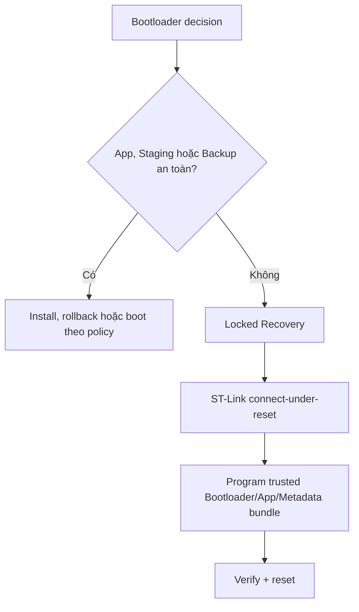

# Recovery

> **Phạm vi:** Đường phục hồi khi Bootloader không còn App/Backup có thể boot an toàn.

> **Tác dụng:** Hướng dẫn phục hồi thiết bị bằng ST-Link và provisioning bundle tin cậy.

## Recovery boundary

Recovery baseline dùng ST-Link/SWD connect-under-reset. Bootloader 16 KB không
chứa normal LoRa receiver, ChaCha session, retry/resume hoặc Delta applier.



USART2 PA2/PA3 ở `115200 8N1` chỉ là debug cục bộ tùy chọn và mặc định không
khởi tạo. Nó không nhận OTA, không phải secure remote recovery và không thay
ST-Link baseline. Khi không bật debug UART, PA2/PA3 được tự do cho chức năng khác.

## Recovery bundle

Bundle phải đến từ release/provisioning flow tin cậy và gồm:

- Bootloader đúng memory map;
- factory/recovery Application đúng APP_BASE;
- Metadata A/B mô tả chính xác Application được provision;
- public key/config đúng device profile.

Sau program phải verify Internal Flash, kiểm vector và reset. Không sửa riêng một
field metadata bằng tay để bypass state/signature policy.

## Entry conditions

- Metadata A/B corrupt và không thể chọn record tin cậy.
- FIRST_BOOT chưa được provision.
- App invalid và không có Backup valid.
- INSTALL/ROLLBACK không thể tiếp tục vì artifact bắt buộc invalid.
- Metadata commit hoặc Internal Flash operation thất bại không thể phục hồi an toàn.

Target update mới sai nhưng App hiện tại valid không phải điều kiện Recovery.

## Acceptance

- Connect-under-reset hoạt động với NRST/SWD wiring đã chốt.
- Trusted bundle program + verify thành công và boot đúng App.
- Recovery không cho boot image ngoài APP_BASE hoặc metadata không khớp.
- Tài liệu/lệnh chỉ rõ vùng Internal Flash bị ghi.

## Tạo bundle và dry-run

Factory Metadata chỉ được tạo từ FULL artifact có CRC và chữ ký hợp lệ với
public key đã provision:

```bash
python3 tools/make_factory_metadata.py \
  --artifact dist/application-v2.aegisfw \
  --public-key dist/release_public_key.bin \
  --output-a dist/metadata-a.bin \
  --output-b dist/metadata-b.bin

python3 tools/recovery_tool.py \
  --bootloader build/release/bootloader/aegis_bootloader.bin \
  --application build/release/application/aegis_application.bin \
  --metadata-a dist/metadata-a.bin \
  --metadata-b dist/metadata-b.bin
```

Lệnh thứ hai mặc định chỉ in command OpenOCD. Kiểm đúng board, NRST/SWD và bundle
rồi mới thêm `--execute`. Tool yêu cầu hai metadata page đúng 1024 byte, kiểm
size Bootloader/Application, program và verify cả bốn vùng.
