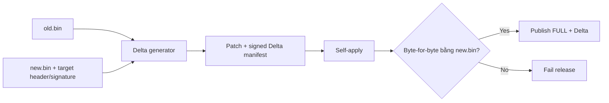

# Release and Artifact

> **Phạm vi:** Chốt byte layout của FULL artifact và nguyên tắc phát hành FULL/Delta.

> **Tác dụng:** Hướng dẫn tạo, kiểm tra, lưu trữ và phát hành artifact bất biến.

> **Bên thực hiện:** Release/CI build, hash, ký và tạo Delta; ESP32 phân phối;
> STM32 Application tiếp nhận/chuẩn bị; Bootloader xác thực độc lập trước khi cài.

## FULL artifact

File `.aegisfw` có đúng ba phần liên tiếp:

```text
offset 0                                      Firmware_SignedHeader_t, 32 bytes
offset 32                                     firmware, image_size bytes
offset 32 + image_size                        Ed25519ph signature, 64 bytes
total                                         image_size + 96 bytes
```

Mọi integer trong SignedHeader dùng little-endian. Không có trailing binary
manifest. JSON release metadata, nếu được tạo, chỉ phục vụ CI/người dùng và không
được STM32 dùng làm nguồn tin cậy.

Nội dung ký:

```text
SHA-512(SignedHeader[32] || firmware[image_size])
 -> Ed25519ph signature[64]
```

Application Update Agent tách header/signature vào Staging manifest và ghi raw
firmware vào Staging Image. Bootloader tự đọc lại hai phần để verify độc lập.

## Delta artifact



Mỗi release luôn xuất FULL artifact. Delta chỉ được publish khi:

- exact base identity đã biết;
- patch nhỏ hơn FULL theo release policy;
- self-apply tạo target byte-for-byte;
- target SignedHeader/signature hợp lệ;
- Delta manifest được ký với domain `AEGIS-F103-DELTA-V1`.

## Artifact identity

`artifact_id` là 64-bit identity được suy ra từ 8 byte đầu của:

```text
SHA-512(SignedHeader || firmware || target_signature)
```

Identity dùng để bind transfer, W25 manifest, boot request và transaction; nó
không thay thế full SHA-512 hoặc Ed25519ph verification.

## Acceptance

- Python và C parse cùng một golden artifact byte-for-byte.
- Trailing byte, truncated header/image/signature và size overflow đều bị từ chối.
- Sửa một byte ở header, firmware hoặc signature làm target verification thất bại.
- Release không được chỉ có Delta; FULL luôn là fallback độc lập.

## Tool flow mẫu

```bash
# 1. Ký FULL và xuất public key provisioning.
python3 tools/sign_firmware.py \
  --bin build/release/application/aegis_application.bin \
  --version 2 \
  --private-key /secure/release_seed.hex \
  --output dist/application-v2.aegisfw \
  --public-key-output dist/release_public_key.bin

# 2. Tạo Delta từ exact base rồi tự apply/verify trước khi xuất.
python3 tools/make_delta.py \
  --base dist/application-v1.bin \
  --base-version 1 \
  --target-artifact dist/application-v2.aegisfw \
  --private-key /secure/release_seed.hex \
  --output dist/v1-to-v2.aegisdelta

# 3. Đóng artifact thành manifest/data mà ESP32 cache và truyền.
python3 tools/package_transfer.py \
  --artifact dist/application-v2.aegisfw \
  --operation-id 0x1002 \
  --transfer-id 0x2002 \
  --output-prefix dist/full-v2

# 4. Ghi size/SHA-512/toolchain vào evidence JSON.
python3 tools/create_release_manifest.py \
  --release-version v2 \
  --artifact dist/application-v2.aegisfw \
  --artifact dist/v1-to-v2.aegisdelta \
  --artifact build/release/bootloader/aegis_bootloader.elf \
  --artifact build/release/application/aegis_application.elf \
  --output dist/release-v2-evidence.json
```

`package_transfer.py` cũng nhận `.aegisdelta`; khi đó output manifest dài 656
byte và data là raw patch. Tool đóng gói kiểm cấu trúc/domain/CRC hoặc patch
SHA-512, nhưng STM32 vẫn phải tự xác thực chữ ký—không tin output chỉ vì Python
đã tạo thành công.
