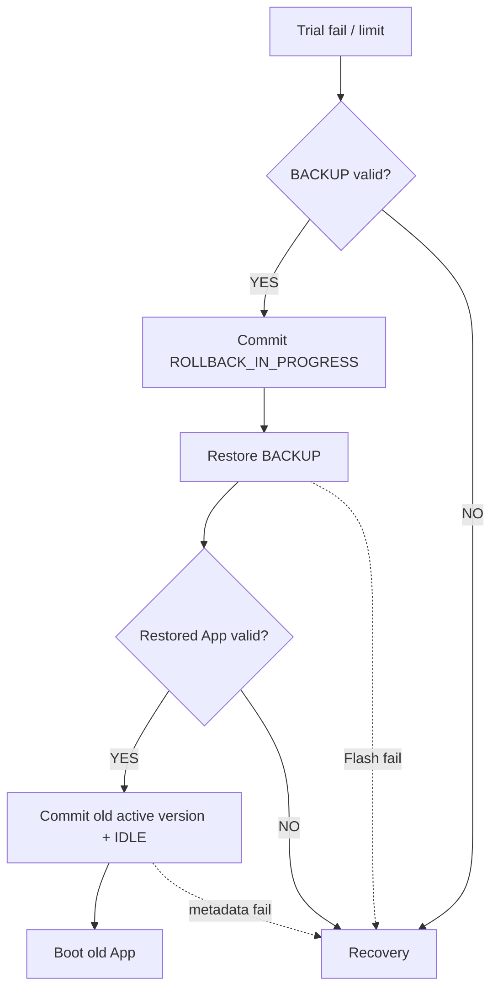

# Rollback Policy

> **Phạm vi (Scope):** Chốt correction rollback: success phải về App cũ + IDLE.

> **Tác dụng:** Quy định điều kiện, thứ tự và kết quả bắt buộc của một lần rollback.

Reset giữa rollback: nếu state vẫn `ROLLBACK_IN_PROGRESS` và backup valid thì tiếp tục rollback.
