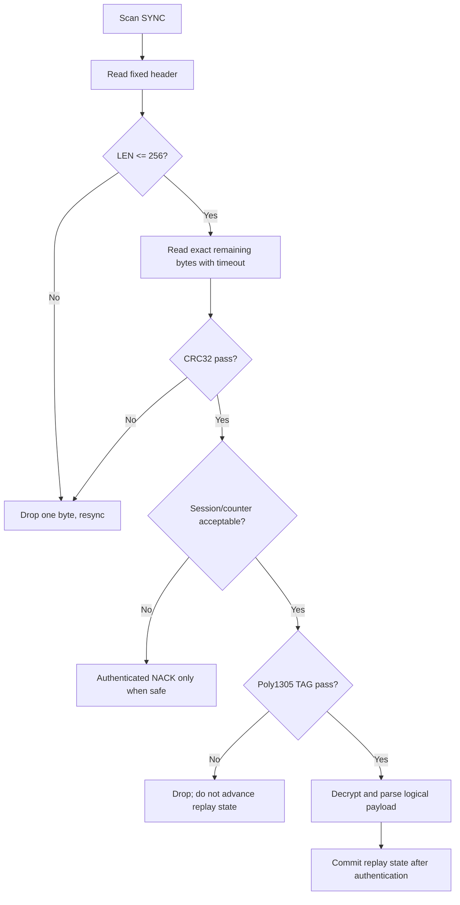

# Secure Transport — ChaCha20-Poly1305

> **Phạm vi:** Byte layout, nonce/AAD, validation order và anti-replay của P2P frame.

> **Tác dụng:** Hướng dẫn mã hóa, xác thực và parse secure frame nhất quán giữa hai đầu.

> **Bên thực hiện:** ESP32 Gateway và STM32 **Application Update Agent** là hai
> endpoint ChaCha20-Poly1305. AS32 chỉ chuyển byte; Bootloader không nhận, giải mã
> hoặc xử lý secure frame P2P.

## Phân chia trách nhiệm

| Thành phần | Trách nhiệm |
|---|---|
| ESP32 Gateway | Tạo session ID, giữ transport key phía gateway, mã hóa frame gửi xuống và xác thực/giải mã frame trả về |
| STM32 Application | Giữ transport key phía node, parse UART, chống replay, xác thực TAG, giải mã command và mã hóa ACK/NACK |
| AS32 #1/#2 | Chuyển byte UART ↔ LoRa P2P, không giữ key và không hiểu frame |
| STM32 Bootloader | Không tham gia transport; chỉ đọc artifact đã commit trong W25Q32 sau reset |

## Frame layout

```text
SYNC(2) = A5 5A
| SESSION_ID(8)
| FRAME_COUNTER(4)
| TYPE(1)
| SEQ(2)
| LEN(2)
| CIPHERTEXT(LEN)
| TAG(16)
| CRC32(4)
```

| Offset | Size | Field | Tác dụng |
|---:|---:|---|---|
| 0 | 2 | SYNC: `0xA5 0x5A` | Giúp parser tìm đầu frame sau noise hoặc frame bị cắt; không phải bằng chứng xác thực. |
| 2 | 8 | SESSION_ID | Nhận diện session hiện tại và tạo 8 byte đầu của nonce. |
| 10 | 4 | FRAME_COUNTER little-endian | Tạo phần còn lại của nonce và chống phát lại; không được lặp với cùng key/session. |
| 14 | 1 | TYPE | Chỉ ra logical command bên trong và được bảo vệ bằng AAD. |
| 15 | 2 | SEQ little-endian | Ghép request với ACK/NACK và phục vụ retry; không dùng thay frame counter. |
| 17 | 2 | LEN little-endian | Giới hạn số byte ciphertext để parser tính đúng chiều dài frame và chống overflow. |
| 19 | LEN | CIPHERTEXT | Payload OTA đã được ChaCha20 mã hóa. |
| 19 + LEN | 16 | Poly1305 TAG | Xác thực ciphertext cùng TYPE/SEQ/LEN; TAG sai thì không giải mã/xử lý payload. |
| 35 + LEN | 4 | CRC32 little-endian | Loại sớm lỗi truyền và hỗ trợ resync trước bước crypto; không cung cấp tính xác thực. |

Fixed overhead là 39 bytes; payload tối đa 256 bytes; raw frame tối đa 295 bytes.
CRC32 bao phủ byte `[SESSION_ID, TAG end]`, tức không gồm SYNC và không gồm chính
field CRC.

## Crypto values

| Value | Size | Tác dụng |
|---|---:|---|
| Transport key | 32 bytes | Bí mật dùng chung giữa ESP32 Gateway và STM32 Application để mã hóa/xác thực frame. |
| Session ID | 8 bytes | Giá trị duy nhất cho mỗi session và là prefix của nonce. |
| Frame counter | 4 bytes | Giá trị duy nhất cho từng frame theo từng chiều và là suffix của nonce. |
| IETF nonce | 12 bytes | Đầu vào nonce của ChaCha20-Poly1305, ghép từ session ID và frame counter. |
| AAD | 5 bytes | Xác thực TYPE/SEQ/LEN nhưng không mã hóa ba field này. |
| Poly1305 TAG | 16 bytes | Kết quả xác thực frame; chỉ khi verify đúng mới được chấp nhận ciphertext. |

```text
nonce = SESSION_ID[8] || FRAME_COUNTER_LE[4]
AAD   = TYPE[1] || SEQ_LE[2] || LEN_LE[2]
```

`SEQ` có thể lặp khi resend. `(key, nonce)` tuyệt đối không được reuse. Hai hướng
dùng counter domain tách biệt:

```text
ESP32 -> STM32: 0x00000000..0x7FFFFFFF
STM32 -> ESP32: 0x80000000..0xFFFFFFFF
```

## Parser và validation



Parser không chờ vô hạn. Timeout frame được tính từ UART 9600, raw frame tối đa,
air-rate profile và margin đo thực tế. UART ISR chỉ đưa byte vào bounded ring
buffer; parse/crypto/storage chạy ngoài ISR.

## Replay và reset

- ESP32 tạo session ID mới bằng nguồn ngẫu nhiên của ESP32.
- STM32 giữ current/last session identity trong W25 receive record khi transfer
  đang active.
- ESP32 persist TX counter hoặc mở session ID mới trước khi gửi sau reboot.
- Receiver chỉ nâng accepted counter sau khi TAG đúng.
- ACK/NACK dùng counter mới thuộc chiều Device → Host.
- Counter chạm cuối domain phải kết thúc session và rekey/reopen; không wrap.

Progress bitmap đảm bảo DATA duplicate idempotent nhưng không thay thế nonce
uniqueness. Session/counter và artifact progress là hai lớp khác nhau.

## Acceptance

- Python/C/ESP32 golden frame giống byte-for-byte.
- Wrong CRC, TAG, session, counter, LEN và truncated frame đều fail-closed.
- TAG sai không thay replay state hoặc W25 progress.
- Resend cùng SEQ dùng frame counter mới.
- Parser recover được sau noise/truncated frame mà không overflow buffer.
