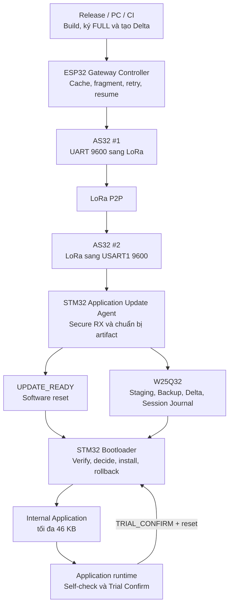
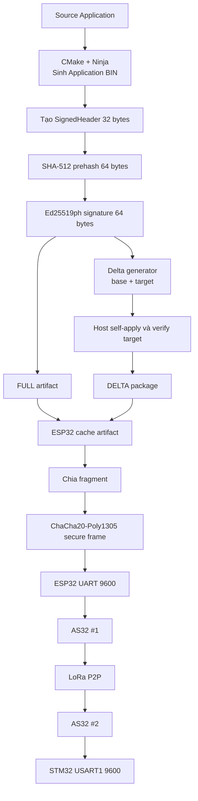
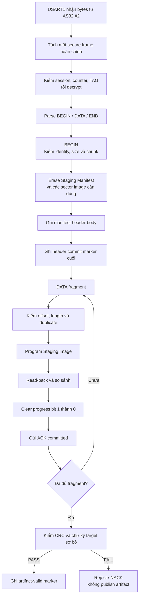
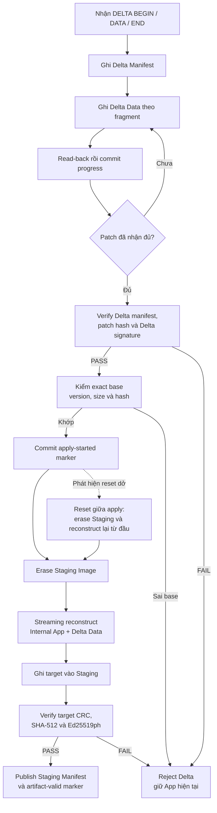
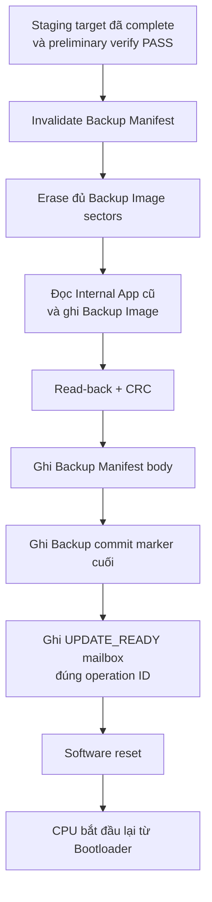
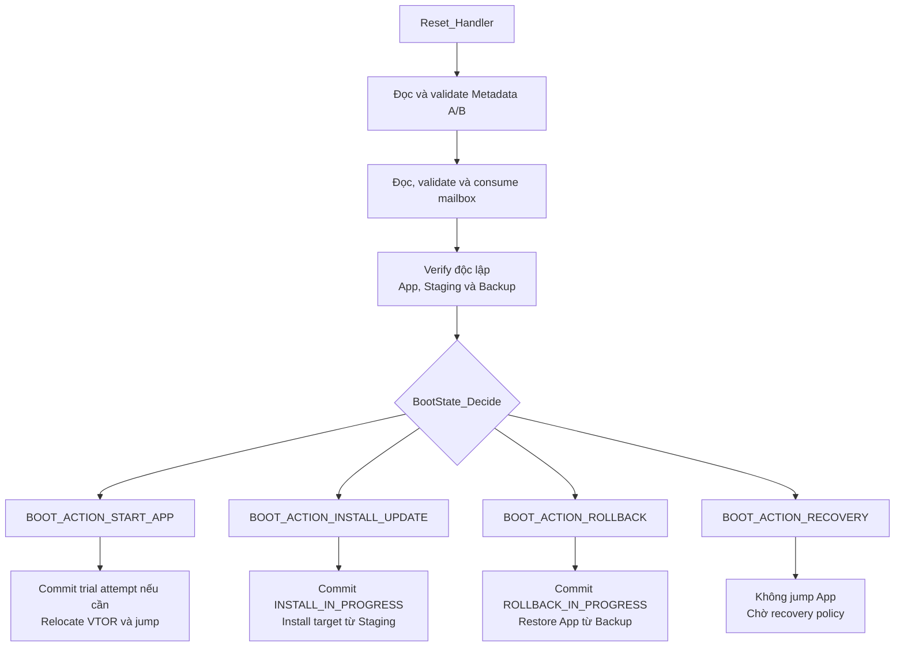
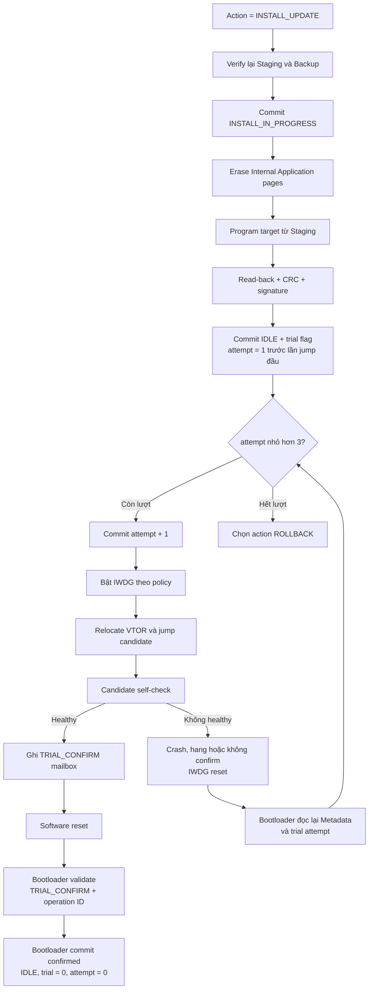
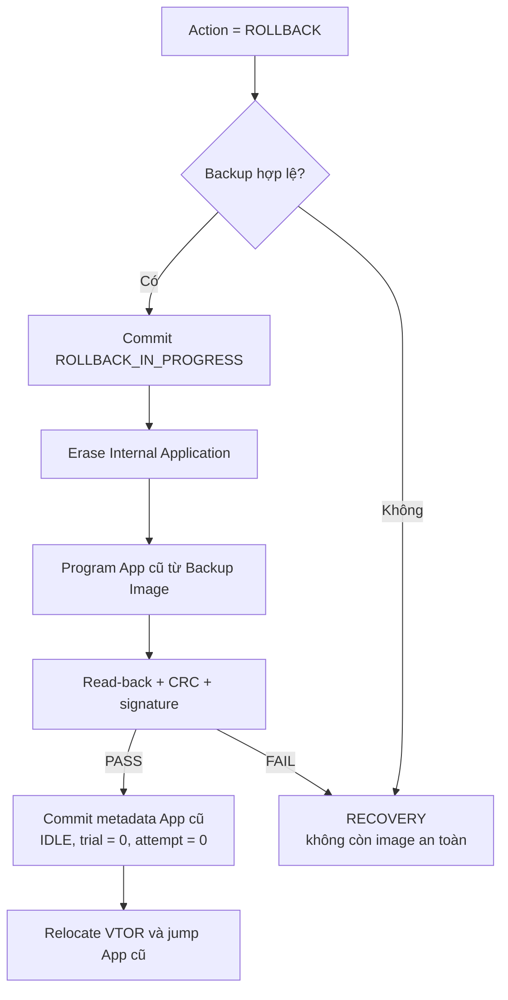

# Sơ đồ luồng tổng thể Aegis-OTA P2P

> **Phạm vi:** Các luồng production từ phát hành artifact, truyền P2P, lưu W25,
> install, Trial Boot đến rollback/recovery.

> **Tác dụng:** Cho phép nhìn riêng từng luồng hệ thống theo sơ đồ dọc, tránh
> trộn ownership và trạng thái của ESP32, Application và Bootloader.

## 1. Tổng quan các thành phần

## 2. Phát hành và truyền artifact qua LoRa P2P

## 3. Nhận FULL vào Staging

## 4. Nhận và áp dụng Delta

## 5. Chuẩn bị Backup và chuyển quyền cho Bootloader

## 6. Bootloader quyết định sau reset

## 7. Install và Trial Boot

## 8. Rollback về Application cũ

