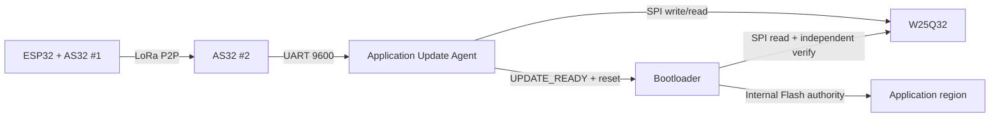

# System Scope — Aegis-OTA P2P

> **Phạm vi (Scope):** Chốt hệ thống ở LoRa P2P với ESP32 Gateway Controller, 2 AS32, STM32F103 và W25Q32.

> **Tác dụng:** Giúp xác định thành phần, mục tiêu, authority và ranh giới của toàn hệ thống.


## Thành phần

```text
Release / PC / CI
      |
ESP32 Gateway Controller
      | UART 9600 8N1
AS32 #1
   ))) LoRa P2P )))
AS32 #2
      | USART1 9600 8N1
STM32F103 Application Update Agent
      |
W25Q32

Software reset + mailbox
      |
STM32F103 Bootloader

ST-Link -- SWDIO / SWCLK / GND / NRST --> STM32F103
```

## Hardware contract

| Thành phần | Contract trong project |
|---|---|
| MCU | STM32F103C8T6 chính thức, 64 KB Internal Flash, 20 KB SRAM |
| External Flash | W25Q32 4 MB nối SPI với STM32 |
| Gateway Controller | ESP32 nhận/cache artifact và điều phối OTA P2P |
| Radio link | Hai AS32-TTL-100-C chạy transparent LoRa P2P |
| Gateway-side link | ESP32 UART ↔ AS32 #1, `9600 8N1` |
| Device-side link | AS32 #2 ↔ USART1 STM32, `9600 8N1` |
| Optional local debug | USART2 STM32 PA2/PA3, `115200 8N1`; mặc định không khởi tạo |
| Python/Cloud ingress | Wi-Fi/network; USB-UART vào ESP32 có thể dùng `115200 8N1` khi cần |
| Debug/program | ST-Link qua SWDIO, SWCLK, GND và NRST khi cần connect-under-reset |

Pin cụ thể thuộc `Shared/pinout_hw.h`. Hai liên kết ESP32–AS32 #1 và
AS32 #2–STM32 đều dùng baseline `9600 8N1`. USART2 debug không thuộc OTA hoặc
Recovery; khi tắt, PA2/PA3 được tự do cho chức năng khác. Channel, air-rate,
TX power và AUX/mode timing phải được khóa bằng profile đo trên đúng hai module.

## Mục tiêu

- signed firmware;
- secure/reliable transport;
- FULL OTA;
- Delta OTA;
- retry/resume;
- power-loss-safe install;
- Trial Boot;
- rollback/recovery;
- fault/security validation.

## Authority

STM32 Bootloader là authority cuối cho verify/install/boot. Application Update
Agent chuẩn bị artifact nhưng không được công nhận hoặc cài candidate. ESP32/AS32
chỉ vận chuyển và điều phối.

- Release signer/CI giữ private signing key và phát hành artifact.
- ESP32 có thể nhận artifact từ PC hoặc upstream service nhưng không có quyền ký.
- AS32 chỉ vận chuyển byte, không hiểu hoặc quyết định firmware hợp lệ.
- STM32 chỉ tin release public key được provision trong Bootloader.

## Ownership boundary

| Thành phần | Được làm | Không được làm |
|---|---|---|
| Application Update Agent | Secure RX, command, progress, W25 writes, preliminary verify, Backup preparation, Delta reconstruct | Ghi Metadata A/B, erase/program Internal App, confirm trực tiếp |
| Bootloader | Verify độc lập, anti-downgrade, metadata, Internal Flash install, trial, rollback, jump | Nhận OTA P2P bình thường, quản lý retry/resume, apply Delta |
| ESP32 | Cache, fragment, retry, STATUS và progress bridge | Ký release, bypass verify, remote-confirm trial |
| AS32 | Chuyển byte UART/LoRa hai chiều | Parse protocol hoặc quyết định artifact valid |



## Threat/fault boundary

Project phải xử lý nghe lén/sửa frame, replay, firmware giả, dữ liệu FULL/DELTA
hỏng hoặc thiếu, lỗi Internal/W25Q32 Flash và reset/mất điện giữa persistent
transaction. Chi tiết test và mitigation nằm trong `threat-model.md`,
`security-negative-tests.md` và `fault-injection.md`.

Phần cứng chưa được chạy nghiệm thu phải ghi `PENDING HARDWARE`; compile thành
công không được thay cho kết quả board/RF thực.

## Invariants

- Không patch trực tiếp Internal Application.
- FULL target phải verify trước install.
- Delta chỉ là bandwidth optimization.
- FULL luôn tồn tại làm fallback.
- Reset giữa transaction phải deterministic.
- Rollback thành công quay về App cũ + IDLE.
- FAULT không phải state.
- Receive/Delta progress nằm trong W25Q32, không ghi Internal metadata mỗi packet.
- Bootloader không erase Application trước khi Staging và Backup đã verify độc lập.
