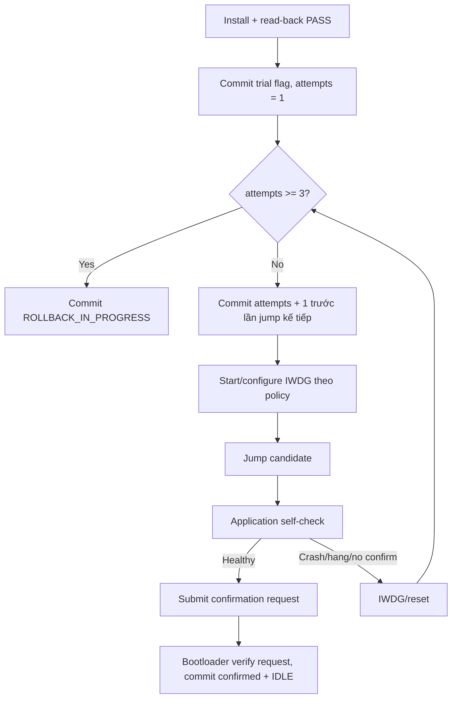

# Trial Boot and IWDG

> **Phạm vi:** Cách Bootloader thử firmware mới, phát hiện firmware không healthy
> và chỉ promote candidate sau xác nhận từ chính Application.

> **Tác dụng:** Hướng dẫn giới hạn lần thử, watchdog, confirm và rollback candidate.

## 1. Trial Boot dùng để làm gì

Read-back và chữ ký chỉ chứng minh firmware đúng byte và đúng nguồn phát hành;
chúng không chứng minh firmware khởi động được, init ngoại vi đúng hoặc chạy ổn
trên board. Trial Boot giữ Backup trong khi cho candidate một số lần chạy có giới
hạn. Nếu candidate không tự chứng minh healthy, Bootloader quay lại App cũ.

## 2. Dữ liệu persistent

| Field | Ai cập nhật | Ý nghĩa |
|---|---|---|
| `trial_boot_flag` | Bootloader | `1` khi candidate chưa được confirm |
| `boot_attempt_count` | Bootloader | Số lần candidate đã được cho phép jump |
| `operation_state` | Bootloader | Transaction install/rollback hiện tại |
| `operation_id` | Bootloader | Bind candidate trong suốt Trial Boot |
| active SignedHeader/signature | Bootloader | Verify App đã cài sau reset và bind trial với đúng candidate |

Application không được ghi thẳng Metadata A/B. Nó ghi `TRIAL_CONFIRM` cùng
operation ID vào BKP mailbox 20 bytes, sau đó software reset. Bootloader consume,
validate request rồi mới commit metadata. Byte layout nằm trong
`boot-request-mailbox.md` và `Shared/boot_mailbox.h`.

SignedHeader/signature không phải dữ liệu trạng thái Trial thuần túy. Sau khi raw
candidate đã được ghi vào Application, đây là bằng chứng firmware duy nhất được
giữ cạnh persistent boot state để Bootloader có thể xác thực lại candidate qua
mọi reset, kể cả khi Staging không còn dùng được. Khi confirm, Bootloader giữ
cặp header/signature này làm identity của App active; khi rollback, nó thay bằng
cặp exact lấy từ Backup manifest sau khi restore và verify thành công.

## 3. Luồng một lần trial

Quy ước count ở trên cho phép tối đa ba lần jump. Install commit `attempts = 1`
trước lần jump đầu; mỗi lần boot Trial kế tiếp kiểm giới hạn rồi tăng và commit
trước khi jump. Nếu reset sau lần thứ ba mà chưa confirm, metadata giữ count `3`
và lần boot tiếp theo phải rollback.

## 4. Điều kiện được confirm

Application chỉ gửi confirm sau các self-check tối thiểu đã chốt cho release, ví
dụ init clock/RAM/peripheral quan trọng, main loop/scheduler chạy và không có lỗi
fatal. Chỉ “đã vào `main()`” chưa đủ nếu lỗi thường xuất hiện sau init.

Confirmation request bind đúng candidate bằng operation/candidate ID để request
cũ không confirm nhầm firmware mới. Magic mailbox được ghi cuối; Bootloader clear
magic khi consume để request không lặp qua reset.

Sau confirm thành công, Bootloader:

- xóa `trial_boot_flag`;
- reset `boot_attempt_count`;
- đặt `operation_id` về 0;
- lưu version/identity active mới;
- commit metadata `IDLE`;
- chỉ sau commit mới báo trạng thái confirmed cho ESP32.

## 5. Vai trò của IWDG

IWDG tạo reset nếu candidate treo hoặc không chạy tới điểm feed hợp lệ. Watchdog
không thay thế attempt counter: IWDG tạo sự kiện reset, còn metadata giúp
Bootloader biết reset lặp lại phải dẫn tới rollback.

- Timeout phải đủ cho boot + self-check thực tế và được đo trên board.
- Baseline source dùng prescaler `256`, reload `4095`, xấp xỉ 26 giây với LSI
  danh định 40 kHz; sai số LSI và thời gian thực phải được đo khi nghiệm thu.
- Không feed watchdog vô điều kiện từ timer ISR vì firmware treo logic vẫn có thể
  được coi là healthy giả.
- Nếu IWDG đã bật, các vòng erase/program/hash lâu của Bootloader phải feed theo
  policy hoặc chia nhỏ công việc.
- Mọi wait phần cứng vẫn cần timeout riêng; không dùng IWDG làm đường thoát duy nhất.
- Vì IWDG không dừng qua software reset, Bootloader và Application tiếp tục feed
  tại các vòng chờ/đọc/ghi dài sau khi candidate đã bật nó.

## 6. Reset và lỗi

| Tình huống | Kết quả |
|---|---|
| Reset trước commit attempt | Không jump candidate; boot lại và commit attempt đúng quy trình |
| Reset/hang sau jump, chưa confirm | Lần boot sau thấy trial và tăng/rollback theo count |
| Confirm request sai candidate | Từ chối, vẫn giữ trial |
| Reset giữa confirm commit | Metadata A/B chọn record cũ hoặc mới hoàn chỉnh, không có half-confirm |
| Hết attempt, Backup valid | Rollback |
| Hết attempt, Backup invalid | Recovery |

## 7. Điều kiện nghiệm thu

- Candidate healthy confirm thành công và metadata về `IDLE`.
- Candidate crash/hang không thể boot vô hạn; sau đúng giới hạn phải rollback.
- Reset ở trước/sau mỗi commit attempt/confirm cho kết quả deterministic.
- ESP32 không thể tạo confirmation hợp lệ thay Application.
- Rollback khôi phục đúng App cũ, verify và xóa trial state.
