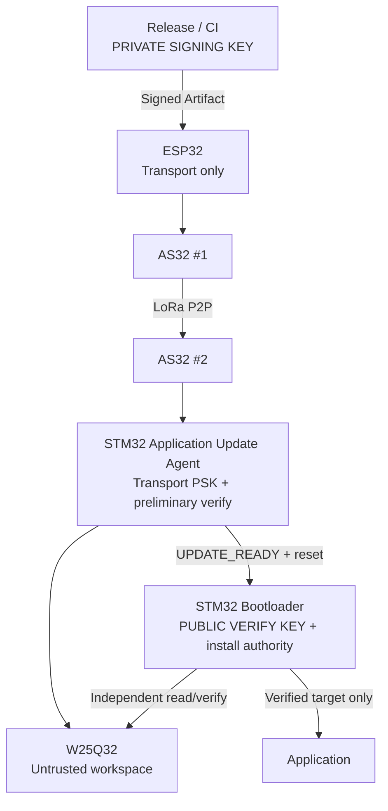

# Trust Model

> **Phạm vi (Scope):** Xác định ai được ký firmware, ai chỉ vận chuyển và ai quyết định install/boot.

> **Tác dụng:** Làm rõ quyền hạn và dữ liệu được tin cậy tại từng thành phần.

- Private signing key: Release/CI only.
- Public verify key: Bootloader và Application preliminary verifier; quyết định
  cuối vẫn thuộc Bootloader.
- Per-device transport PSK: ESP32 và STM32 Application, chỉ bảo vệ transport.
- ESP32/AS32 không có firmware install authority.
- W25Q32 không phải trust anchor; mọi manifest/image phải được kiểm trước khi dùng.
