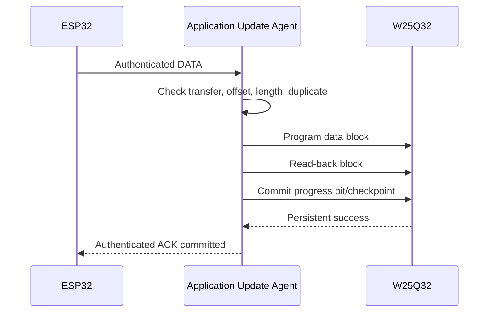
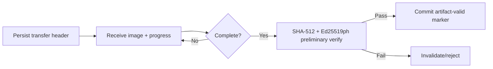
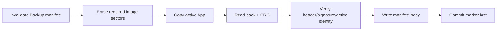
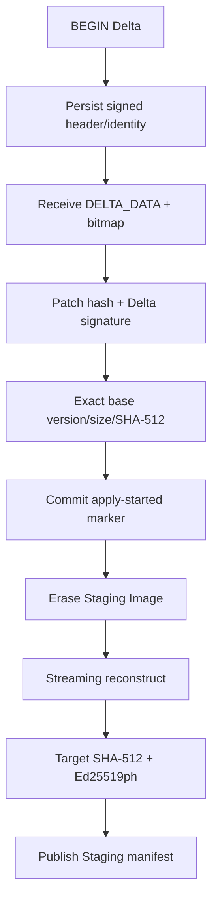

# W25Q32 Storage

> **Phạm vi:** Vai trò, vòng đời và commit contract của Staging, Backup và Delta.

> **Tác dụng:** Hướng dẫn sử dụng từng phân vùng W25Q32 và giữ dữ liệu an toàn qua reset.

W25Q32 là workspace bền vững, không phải nơi STM32 thực thi Application.

## Ba vùng chức năng

| Vùng | Nội dung | Producer | Consumer | Mục đích |
|---|---|---|---|---|
| Staging | Manifest 4 KB + full target image | FULL receiver hoặc Delta applier trong Application | Application preliminary verifier và Bootloader | Candidate hoàn chỉnh trước install |
| Backup | Manifest 4 KB + App cũ | Application Update Agent | Bootloader rollback | Đường quay về khi install/trial lỗi |
| Delta | Manifest 4 KB + raw patch | Application receiver | Application Delta verifier/applier | Nguyên liệu reconstruct Staging |
| Session Journal, trong Reserved | Record session ID 16 bytes, append-only | Application secure-session gate | Application secure-session gate | Chặn mở lại session cũ/reuse nonce qua reset |
| Future Reserved | Chưa có production format | Không module nào | Không module nào | Giữ nguyên cho mở rộng sau này |

```text
đã nhận byte != artifact complete
artifact complete != artifact authenticated
artifact authenticated != đã install
đã install != đã confirm
```

## Layer ownership

| Layer | Làm gì |
|---|---|
| `ext_flash` | SPI primitive, timeout, JEDEC ID, read/program/erase/read-back |
| Application artifact storage | Range mapping, prepare, progress, manifest commit và invalidate |
| Application OTA receiver | Transfer/offset/duplicate, gọi storage rồi ACK/NACK |
| Application verifier/applier | Verify sơ bộ FULL/Delta và reconstruct Delta sang Staging |
| Bootloader validator | Chỉ đọc manifest/image, verify độc lập trước install/rollback |
| Bootloader installer | Program Internal App theo persistent operation state |
| Application session store | Append session ID sau TAG hợp lệ, từ chối ID đã dùng qua reset |

Bootloader không xử lý normal P2P receive, retry/resume hoặc Delta apply. Điều đó
giữ Bootloader nhỏ; quyền install vẫn không chuyển cho Application.

## Session journal

`0x0C0000..0x0CFFFF` chứa 4096 record 16 bytes. Mỗi record gồm session ID 8
bytes, CRC32 4 bytes và commit marker 4 bytes ghi cuối. Record mất điện trước
marker bị bỏ qua nhưng không được ghi đè; record đã commit trùng ID khiến session
mới bị từ chối. Journal đầy hoặc corrupt phải fail-closed.

Journal không tự erase khi OTA. Chỉ local factory/reprovision flow được gọi
`TransportSessionStore_EraseForProvisioning()` sau khi transport key đã được
thay; không cung cấp command radio để xóa lịch sử chống replay.

## Manifest và progress

Sector manifest của Staging/Delta giữ:

- format và artifact/transfer identity;
- declared size, fragment size/count;
- SignedHeader/signature hoặc Delta signed body;
- progress bitmap;
- record CRC;
- header, artifact-valid và apply marker cần thiết.

Với data chunk 224 bytes, vùng data 252 KB có tối đa 1152 fragment nên bitmap cần
1152 bit, tức 144 bytes. Một bit chỉ được clear sau khi fragment đã program và
read-back đúng.

### Staging manifest byte contract

| Offset | Size | Field | Tác dụng |
|---:|---:|---|---|
| 0 | 4 | `magic` | Nhận diện đây là Staging Manifest của Aegis, không phải sector erased hoặc dữ liệu ngẫu nhiên. |
| 4 | 4 | `format_version` | Cho biết phiên bản layout manifest để code không đọc nhầm schema cũ/mới; đây không phải version firmware. |
| 8 | 1 | `artifact_type` | Chốt loại artifact; Staging chỉ được publish dưới dạng FULL target hoàn chỉnh, kể cả khi target được reconstruct từ Delta. |
| 9 | 1 | `reserved0` | Phải bằng `0`; dành chỗ mở rộng schema và giúp phát hiện record sai layout. |
| 10 | 2 | `chunk_size` | Kích thước DATA fragment chuẩn, baseline 224 bytes; dùng kiểm offset/length và tính fragment index. |
| 12 | 8 | `operation_id` | Liên kết Staging, Backup, mailbox và Metadata với cùng một transaction cài đặt; ngăn dùng nhầm artifact của lần update khác. |
| 20 | 8 | `transfer_id` | Nhận diện riêng phiên truyền hiện tại để resume đúng phiên và từ chối DATA/ACK muộn của phiên cũ. |
| 28 | 8 | `artifact_id` | Nhận diện candidate target cụ thể trong protocol; dùng bind BEGIN/DATA/END nhưng không thay thế chữ ký crypto. |
| 36 | 32 | `image_header` | SignedHeader mô tả target: domain, format, image size, image version và image CRC32. |
| 68 | 64 | `image_signature` | Chữ ký Ed25519ph do Release/CI tạo; Application kiểm sơ bộ và Bootloader verify độc lập cùng target image. |
| 132 | 4 | `data_size` | Số byte raw firmware cần nhận/đọc; phải bằng `image_header.image_size` và không vượt Application slot. |
| 136 | 2 | `fragment_count` | Tổng số fragment dự kiến; xác định bao nhiêu bit đầu của progress bitmap phải được clear trước END. |
| 138 | 2 | `reserved1` | Phải bằng `0`; giữ layout ổn định cho mở rộng tương lai. |
| 140 | 4 | `header_crc32` | Phát hiện manifest header hỏng hoặc ghi sai; bao phủ byte `[0, 140)`, không tạo tính xác thực như chữ ký. |
| 144 | 4 | `header_commit_marker` | Ghi sau header body để công bố header hoàn chỉnh; marker này chỉ cho phép nhận/resume, chưa chứng minh image đã nhận đủ hoặc trusted. |
| 148 | 108 | `reserved_erased` | Phải giữ `0xFF`; dành chỗ cho schema sau và tránh program các byte chưa có ý nghĩa trong NOR Flash. |
| 256 | 1152 bits / 144 bytes | `progress_bitmap` | Mỗi bit ứng với một fragment: `1` là chưa commit, `0` là đã program và read-back đúng; dùng resume và phát hiện duplicate sau reset. |
| 400 | 4 | `artifact_valid_marker` | Chỉ ghi cuối sau khi đủ fragment và Application preliminary verify PASS; Bootloader vẫn phải verify độc lập trước install. |

Record dùng đến offset 404 của sector manifest 4 KB. Receive state được suy ra
từ header marker, bitmap và valid marker; không rewrite một enum state trong NOR.
Giá trị khóa: magic `0x53544731`, format `1`, header marker `0x48445231`,
artifact-valid marker `0x56414C31`; erased marker là `0xFFFFFFFF`.



Mất ACK tạo duplicate. Nếu progress đã commit, receiver đọc/so data: giống thì
ACK lại, khác thì NACK và không ghi đè âm thầm.

## Staging lifecycle



Staging manifest giữ `Firmware_SignedHeader_t`, target signature, operation/artifact
identity và progress. Staging Image chỉ chứa raw firmware; image offset 0 bắt đầu
tại `W25Q32_STAGING_IMAGE_BASE`.

Bootloader chỉ coi Staging valid khi:

- manifest/body/marker/range hợp lệ;
- operation ID khớp UPDATE_READY hoặc metadata đang INSTALL;
- image CRC đúng;
- SignedHeader/domain/version policy đúng;
- Ed25519ph verify độc lập PASS.

## Backup lifecycle



Backup manifest có byte contract sau:

| Offset | Size | Field | Tác dụng |
|---:|---:|---|---|
| 0 | 4 | Magic | Nhận diện đây là Backup manifest của Aegis, không phải dữ liệu ngẫu nhiên trong sector. |
| 4 | 4 | Format version | Cho biết phiên bản layout manifest; đây không phải version firmware. |
| 8 | 8 | Operation ID | Ràng buộc Backup của App cũ với đúng lần install/trial đang thực hiện. |
| 16 | 32 | Exact active SignedHeader | Mô tả chính xác App cũ đã copy: domain, format, kích thước, version và CRC32. |
| 48 | 64 | Active Ed25519ph signature | Cho phép Bootloader xác thực độc lập App cũ sau khi restore từ Backup. |
| 112 | 4 | Manifest CRC32, bao phủ byte `[0, 112)` | Phát hiện manifest hỏng hoặc ghi dở; CRC không thay thế chữ ký firmware. |
| 116 | 4 | Commit marker, ghi cuối | Công bố Backup hoàn chỉnh sau khi image đã copy, read-back và verify; thiếu marker thì Backup invalid. |

Backup manifest dài đúng 120 bytes. Nó chứa image CRC trong SignedHeader và chữ
ký của active App. Backup chỉ hợp lệ nếu khớp App được metadata mô
tả; một firmware signed nhưng không phải predecessor của trial không được dùng
làm Backup.

Giá trị khóa: magic `0x424B5550`, format `2`, commit marker `0x434D4954`;
erased marker là `0xFFFFFFFF`.

Reset trước commit marker để lại Backup invalid, trong khi Internal App vẫn chưa
bị erase. Bootloader phải kiểm cả Ed25519ph, không chỉ manifest CRC/image CRC.

## Delta lifecycle



Reset khi receive thì resume theo bitmap. Reset khi apply thì Application erase
Staging Image và reconstruct lại từ đầu; không cần persist opcode giữa chừng.
Delta không được ghi trực tiếp Internal Application.

## BEGIN, DATA, END

### BEGIN

1. Authenticate secure frame.
2. Kiểm artifact type, target/device, format, size và overflow.
3. So transfer/artifact identity với record đang tồn tại.
4. Resume record khớp hoặc invalidate/erase đúng vùng cho transfer mới.
5. Persist header trước khi ACK BEGIN.

### DATA

1. Kiểm identity, offset, length và payload length.
2. Program đúng vùng data.
3. Read-back.
4. Commit progress.
5. Chỉ sau đó ACK.

### END

1. Chứng minh bitmap/length complete, không có hole.
2. Tính hash từ data trong W25Q32.
3. Verify signature và policy tương ứng.
4. Ghi artifact-valid marker cuối.
5. Trả status VERIFIED hoặc REJECTED.

## Reset/error policy

| Điểm lỗi | Hành vi |
|---|---|
| FULL/Delta receive dở | Resume đúng identity/progress |
| Backup trước marker | Backup invalid; App hiện tại vẫn nguyên |
| Delta apply dở | Reconstruct Staging lại từ đầu |
| Candidate verify fail | Reject candidate, giữ App hiện tại |
| SPI/BUSY/read-back timeout | Dừng thao tác, không ACK committed |
| Backup invalid khi rollback bắt buộc | Recovery nếu App cũng không an toàn |

## Acceptance

- Mọi range API không thể chạm manifest hoặc vùng kế bên.
- Erase sector-aligned, Page Program không vượt page và mọi wait có timeout.
- Reset trước bất kỳ marker nào không thể tạo artifact valid giả.
- FULL/Delta không ACK trước data + progress persistence.
- Bootloader verify Staging và Backup độc lập trước thao tác phá hủy.
